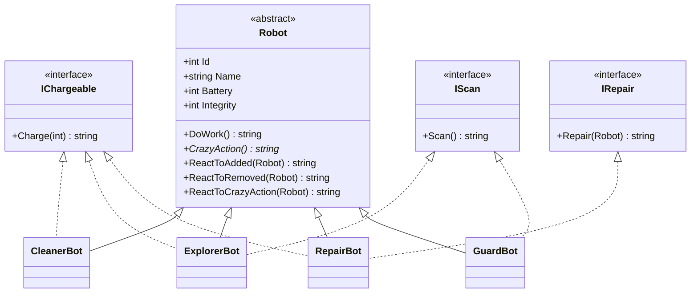
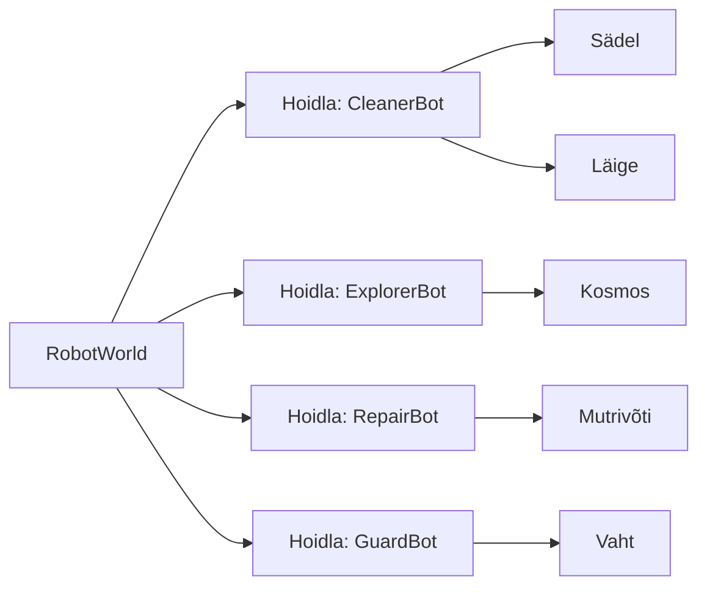
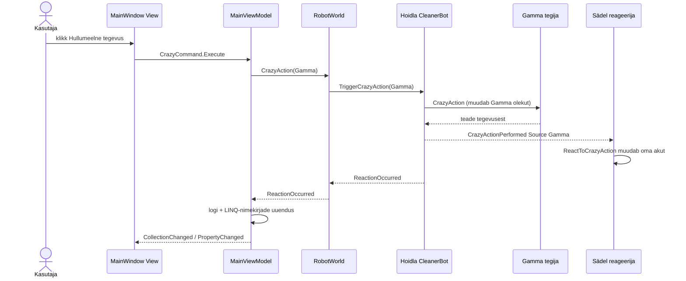

# Robotite planeet (Robot Planet)

WPF-rakendus, kus erinevad robotid elavad samas maailmas, kuid käituvad erinevalt.

* **Vol.1 (Kodutöö 3):** pärilus, liidesed, polümorfism, `CrazyAction()`, kollektsioon.
* **Vol.2 (Kodutöö 4):** tüübipõhised hoidlad (generics), sündmused ja naabrite reaktsioonid, LINQ-päringud ja kohustuslik MVVM.

Sama maailm ja samad tegelased kasvavad edasi: uut universumit ega uut projekti ei loodud.

## Sisukord

1. [Valitud maailm ja rakenduse eesmärk](#1-valitud-maailm-ja-rakenduse-eesmärk)
2. [Käivitamisjuhend](#2-käivitamisjuhend)
3. [Projekti struktuur](#3-projekti-struktuur)
4. [Klassihierarhia ja liidesed](#4-klassihierarhia-ja-liidesed)
5. [CrazyAction ja olekureeglid](#5-crazyaction-ja-olekureeglid)
6. [Hoidlad ja generics](#6-hoidlad-ja-generics)
7. [Sündmused ja reaktsioonid](#7-sündmused-ja-reaktsioonid)
8. [LINQ-päringud](#8-linq-päringud)
9. [MVVM: Model, ViewModel, View](#9-mvvm-model-viewmodel-view)
10. [Kasutajaliides](#10-kasutajaliides)
11. [Iseseisvalt õpitud WPF UI elemendid](#11-iseseisvalt-õpitud-wpf-ui-elemendid)
12. [Kontrollitud kasutusjuhud](#12-kontrollitud-kasutusjuhud)
13. [Git-koostöö](#13-git-koostöö)
14. [Esitamine](#14-esitamine)
15. [AI kasutamine](#15-ai-kasutamine)

---

## 1. Valitud maailm ja rakenduse eesmärk

Valitud maailm: **ROBOT PLANET**. Planeedil elavad neli tüüpi roboteid: `CleanerBot`, `ExplorerBot`, `RepairBot` ja `GuardBot`. Neil on ühine baastüüp `Robot` (aku ja terviklikkus), kuid igaühel on oma tavaline tegevus, oma võimed (liidesed) ja oma hullumeelne tegevus `CrazyAction()`.

**Praktikumi garaaži põhimõte (Vol.2):** iga robotitüüp saab oma hoidla ning selles olevad robotid reageerivad üksteise tegevusele. Näiteks kui üks `CleanerBot` küürib end värvist puhtaks, koristavad teised `CleanerBot`-id tema segaduse ära. `ExplorerBot`-id seda ei märka, sest nad elavad teises hoidlas.

Kõik domeenireeglid (robotid, hoidlad, sündmused, reaktsioonid) asuvad Core-projektis. WPF-projekt ainult juhib ja kuvab.

## 2. Käivitamisjuhend

**Nõuded:** Windows 10/11, .NET 10 SDK, Visual Studio töökoormusega *.NET desktop development*.

```bash
git clone <REPOSITORY-URL>
cd RobotPlanet
git checkout vol2/events-linq-mvvm
dotnet run --project RobotPlanet.Wpf
```

Alternatiiv: ava `RobotPlanet.sln` Visual Studios, määra `RobotPlanet.Wpf` käivitusprojektiks ja vajuta **F5**.

**Demoandmed** (lisatakse käivitamisel):

| ID | Nimi | Tüüp | Aku | Terviklikkus |
|---|---|---|---|---|
| 1 | Sädel | CleanerBot | 100 | 100 |
| 2 | Läige | CleanerBot | 100 | 100 |
| 3 | Kosmos | ExplorerBot | 80 | 100 |
| 4 | Mutrivõti | RepairBot | 100 | 60 |
| 5 | Vaht | GuardBot | 100 | 100 |

## 3. Projekti struktuur

```
RobotPlanet.sln
├── RobotPlanet.Core                 MODEL (klassiteek, ei sõltu WPF-ist)
│   ├── entities/                    Robot, CleanerBot, ExplorerBot, RepairBot, GuardBot
│   ├── interface/                   IChargeable, IScan, IRepair, IRepository<T>, IRobotRepository
│   ├── events/                      RobotEventKind, RobotEventArgs, ReactionEventArgs
│   ├── repository/                  Repository<T>
│   ├── RobotKind.cs                 roboti tüüpide loend
│   ├── RobotWorld.cs                hoidlate register + domeenireeglid
│   └── Properties/Resources.resx    teated (eesti keeles)
└── RobotPlanet.Wpf                  VIEWMODEL + VIEW (viitab Core-projektile)
    ├── ViewModels/
    │   ├── ViewModelBase.cs         INotifyPropertyChanged
    │   ├── RelayCommand.cs          ICommand + CanExecute
    │   ├── MainViewModel.cs         valik, käsud, LINQ-tulemused, logi
    │   └── ViewModelTypes.cs        SortChoice, GroupSummary, RepositoryItem
    ├── MainWindow.xaml              VIEW: ainult sidumised (binding)
    ├── MainWindow.xaml.cs           ainult paigutus (kitsal ekraanil)
    └── Properties/Resources.resx    kasutajaliidese tekstid
```

## 4. Klassihierarhia ja liidesed



### Klassid

| Klass | Liidesed | `DoWork()` (tavaline tegevus) | `CrazyAction()` |
|---|---|---|---|
| `CleanerBot` | `IChargeable` | koristab põrandat, −5 akut | küürib end puhtaks, pesi värvi maha: −15 akut, −10 terviklikkust |
| `ExplorerBot` | `IChargeable`, `IScan` | uurib ümbrust, −10 akut | avastab "uue planeedi", mis on tema enda vari: −20 akut |
| `RepairBot` | `IChargeable`, `IRepair` | ootab katkiseid (olek ei muutu) | parandab kõike järjest: −10 akut, −5 terviklikkust |
| `GuardBot` | `IScan` | patrullib (olek ei muutu) | arreteerib oma varju: −5 terviklikkust |

`ExplorerBot` ja `RepairBot` täidavad kaht rolli korraga (kaks liidest).

### Liidesed

| Liides | Meetod | Kirjeldus |
|---|---|---|
| `IChargeable` | `string Charge(int amount)` | roboti akut saab laadida |
| `IScan` | `string Scan()` | robot oskab ümbrust skaneerida |
| `IRepair` | `string Repair(Robot target)` | robot oskab teist robotit parandada |
| `IRepository<T>` | `Add`, `Remove`, `GetAll`, `Find` | tüübipõhine hoidla (vt punkt 6) |
| `IRobotRepository` | `Title`, `Count`, `Robots` | hoidla kirjutuskaitstud vaade registrile ja UI-le |

`GuardBot` ei ole laetav (tal on reaktor). See on teadlik valik, et võimete kontroll `is` / `as` operaatoriga annaks tüüpide vahel päris erineva tulemuse.

### Polümorfism ja võimete kontroll

* `DoWork()` on `virtual`, `CrazyAction()` on `abstract`. Alamklassid muudavad neid `override` abil.
* Samamoodi on `ReactToAdded`, `ReactToRemoved` ja `ReactToCrazyAction` `virtual` meetodid: iga tüüp võib reageerida omamoodi.
* Käitumist **ei valita** tüübipõhise `if` / `switch` plokiga. Hoidla ja ViewModel kutsuvad meetodeid baastüübi `Robot` kaudu.
* `RobotWorld` ja ViewModel kontrollivad võimeid operaatoritega `is` ja `as` (`robot is IChargeable`, `robot as IScan`, `healer is IRepair`).

## 5. CrazyAction ja olekureeglid

### CrazyAction tegevused

| Robot | Tingimus | Tulemus |
|---|---|---|
| `CleanerBot` | aku < 15 | keeldub, olek ei muutu |
| `CleanerBot` | aku ≥ 15 | aku −15, terviklikkus −10 |
| `ExplorerBot` | aku < 20 | keeldub, olek ei muutu |
| `ExplorerBot` | aku ≥ 20 | aku −20 |
| `RepairBot` | terviklikkus < 20 | laguneb ise koost, keeldub |
| `RepairBot` | aku < 10 | keeldub, olek ei muutu |
| `RepairBot` | muidu | aku −10, terviklikkus −5 |
| `GuardBot` | terviklikkus < 30 | jääb vahipostil magama, olek ei muutu |
| `GuardBot` | muidu | terviklikkus −5 |

### Olekureeglid ja valideerimine

* **Identiteet** (`Id`, `Name`) määratakse konstruktoris ja on ainult loetav.
* `Id`: 0–999999 ja **unikaalne kogu maailmas** (kontrollib `RobotWorld.TryAdd`, ka teise tüübi robotite vastu).
* `Name`: pärast `Trim()` 2–20 märki, mitte tühi.
* `Battery` ja `Integrity`: 0–100. Setter on `private`, muutmine käib ainult kaitstud meetoditega `TrySpendBattery`, `TryAddBattery`, `TryDamage`, `TryRestoreIntegrity`.
* Need meetodid **keelduvad vigasest sisendist ja ei muuda olekut** (negatiivne kogus, liiga vähe akut).
* `ReceiveRepair(int)` on ainus avalik remondisisend: kogus 1–100, ideaalses seisus robotit ei paranda.
* Vigane konstruktoriargument annab `ArgumentException`, mille `RobotWorld.TryAdd` püüab kinni ja tagastab sõnumina. Rakendus ei sulgu.
* Tekstisisend muudetakse arvuks ViewModelis (`int.TryParse`), ülejäänud reeglid kontrollib Core.

## 6. Hoidlad ja generics

```csharp
public interface IRepository<T> where T : Robot
{
    void Add(T item);
    bool Remove(T item);
    IEnumerable<T> GetAll();
    T? Find(Func<T, bool> predicate);
}

public class Repository<T> : IRepository<T>, IRobotRepository where T : Robot
```

* **Iga konkreetse tüübi jaoks eraldi hoidla:** `Repository<CleanerBot>`, `Repository<ExplorerBot>`, `Repository<RepairBot>`, `Repository<GuardBot>`. Hoidlad on loodud selle maailma enda klassidest.
* **Piirang `where T : Robot`** tuleneb maailma olemasolevast ühisest baastüübist. Vale tüübi lisamist takistab **kompilaator**, mitte nimede võrdlemine kasutajaliideses:

  | Katse | Kompilaatori vastus |
  |---|---|
  | `new Repository<string>()` | `CS0311`: `string` ei ole `Robot` |
  | `Repository<CleanerBot>.Add(new GuardBot(...))` | `CS1503`: `GuardBot` ei ole `CleanerBot` |

* `Repository<T>` hoiab robotid `ObservableCollection<T>`-is ja annab UI-le välja kirjutuskaitstud `ReadOnlyObservableCollection<T>` (`Items`). UI ei saa roboteid otse lisada ega eemaldada.
* `RobotWorld` on hoidlate **register**. Konstruktoris on iga tüübi kohta üks rida:

  ```csharp
  Register(RobotKind.Cleaner, (id, name, battery, integrity) => new CleanerBot(id, name, battery, integrity));
  ```

  Uue tüübi lisamiseks piisab uuest klassist, uuest `RobotKind` väärtusest ja ühest `Register`-reast. Hoidla, sündmused, tellimused ja UI-kuvamine tekivad automaatselt.
* `RobotWorld` leiab roboti hoidla **täpse tüübi** järgi (`GetType() == typeof(T)`), seega robot ei satu kunagi teise tüübi hoidlasse.



Sama hoidla robotid kuulavad üksteist. Eri hoidlate robotid ei kuule üksteist.

## 7. Sündmused ja reaktsioonid

Sündmused ja reaktsioonid kuuluvad **domeeniloogikasse (Core)**, mitte WPF-nupu sündmuskäsitleja sisse.

### Kolm sündmust (`Repository<T>`)

| Sündmus | Millal | Kes reageerib |
|---|---|---|
| `ItemAdded` | hoidlasse lisatakse robot | kõik **senised** selle hoidla robotid tervitavad uut tulijat; uus robot ei tervita iseennast |
| `ItemRemoved` | robot eemaldatakse hoidlast | allesjäänud robotid reageerivad lahkumisele; eemaldatud robot enam ei reageeri |
| `CrazyActionPerformed` | robot teeb oma `CrazyAction()` | teised sama hoidla robotid reageerivad; tegevuse põhjustaja ei reageeri iseendale |

Iga sündmus kannab `RobotEventArgs`: `Source` (milline robot tegevuse põhjustas) ja `Kind` (mis juhtus). Iga reaktsioon jätab logikirje: hoidla tõstab `ReactionOccurred` (`ReactionEventArgs` koos reageerija, põhjuse ja sõnumiga).

### Tellimuste haldus

* `Add`: robot lisatakse kollektsiooni ja **tellitakse** kõigile kolmele sündmusele.
* `Remove`: robot **tühistab** kõik kolm tellimust enne, kui `ItemRemoved` tõstetakse. Seetõttu ei reageeri eemaldatud robot ei oma lahkumisele ega hilisematele sündmustele.
* `React(...)` jätab sündmuse vahele, kui `e.Source` on reageerija ise.
* Tellimuste hoidmiseks on `Dictionary<T, Subscription>`, et sama delegaadi saaks hiljem tühistada.

### Reaktsioonid (igal tüübil oma)

| Robot | Sündmus | Reaktsioon | Muudab reageerija olekut? |
|---|---|---|---|
| kõik (vaikimisi) | lisamine / eemaldamine / CrazyAction | teade, et robot tervitab / vaatab kurvalt / vaatab pealt | ei |
| `CleanerBot` | CrazyAction | koristab teise tekitatud segaduse ära | **jah:** aku −3 (liiga väsinuna ei korista) |
| `ExplorerBot` | lisamine | asub uurima tulijat | **jah:** aku −2 (liiga väsinuna ei uuri) |
| `ExplorerBot` | eemaldamine | märgib kaardile, et robot on kadunud | ei |
| `RepairBot` | CrazyAction | märkab pahandust ja lappab end | **jah:** terviklikkus +3 (kuni 100) |
| `RepairBot` | eemaldamine | kogub lahkunu varuosad | ei |
| `GuardBot` | lisamine | kontrollib tulija ID-d | ei |
| `GuardBot` | CrazyAction | nõuab tegijalt seletust | ei |

Vähemalt kolm reaktsiooni muudavad reageerija olekut (aku või terviklikkus).

### Ühe sündmuse teekond (näide: `Gamma` teeb `CrazyAction()`)



Sammud sõnadega:

1. **View:** nupp on seotud käsuga `CrazyCommand` (`Command="{Binding CrazyCommand}"`), koodis pole `Click`-sündmust.
2. **ViewModel:** `RelayCommand` käivitab `Crazy()`, mis läheb läbi `Run(...)`.
3. **Model:** `RobotWorld` leiab roboti hoidla ja kutsub `Repository<T>.TriggerCrazyAction(actor)`.
4. Hoidla kutsub polümorfselt `actor.CrazyAction()` (muudab tegija olekut) ja tõstab `CrazyActionPerformed`.
5. Iga tellitud robot (v.a tegija) käivitab oma `ReactToCrazyAction(...)`, mis võib muuta tema enda olekut, ja hoidla tõstab `ReactionOccurred`.
6. `RobotWorld` edastab reaktsiooni ühe sündmusena. ViewModel kogub selle tegevuse sõnumi alla.
7. `Run` kirjutab logisse esmalt tegevuse rea ja selle alla reaktsioonid (`↳`), seejärel uuendab LINQ-nimekirjad, kokkuvõtte ja käskude `CanExecute`.
8. `Robot` teavitab oleku muutusest (`INotifyPropertyChanged`), seega aku- ja terviklikkuseribad uuenevad ise.

## 8. LINQ-päringud

Kolm päringut asuvad `MainViewModel`-is ja nende tulemused kuvatakse kasutajaliideses:

| Päring | Operaator | Kus UI-s | Kood |
|---|---|---|---|
| **Otsimine** | `Where` | otsinguväli "Otsi nime või ID järgi" | `query.Where(r => r.Name.Contains(text, StringComparison.CurrentCultureIgnoreCase) \|\| r.Id.ToString().Contains(text))` |
| **Sorteerimine** | `OrderBy` / `OrderByDescending` | valik "Sorteeri" (nimi, aku, terviklikkus, ID) ja märkeruut "Kahanevalt" | `SortDescending ? query.OrderByDescending(r => r.Battery) : query.OrderBy(r => r.Battery)` |
| **Grupeerimine** | `GroupBy` | kaart "Kokkuvõte" | `_world.Robots.GroupBy(r => r.Kind).Select(g => new GroupSummary(g.Key, g.Count(), (int)Math.Round(g.Average(r => r.Battery)), (int)Math.Round(g.Average(r => r.Integrity))))` |

* Otsing ja sorteerimine töötavad valitud hoidla robotitel (`VisibleRobots`).
* Kokkuvõte ühendab kõigi hoidlate lugemisvaated (`RobotWorld.Robots`) ja näitab iga tüübi robotite arvu ning keskmist akut ja terviklikkust.
* Pärast iga tegevust arvutatakse päringud uuesti, seega nimekiri ja kokkuvõte uuenevad automaatselt.
* Nimekirja uuendab `Sync(...)` meetod (`Remove` / `Move` / `Insert`, mitte `Clear` + `Add`), et valitud robot jääks valituks.

## 9. MVVM: Model, ViewModel, View

| Kiht | Vastutus | Kus |
|---|---|---|
| **Model (Core)** | robotid, hoidlad, sündmused, reaktsioonide reeglid, valideerimine. Ei sõltu WPF-ist | `RobotPlanet.Core` |
| **ViewModel** | valitud hoidla ja robot, kuvatavad loendid, LINQ-päringute tulemused, logi, kasutaja käsud (`ICommand`) | `RobotPlanet.Wpf/ViewModels` |
| **View** | ainult kujundus ja sidumised (`Binding`). Kood-taga on ainult paigutus | `MainWindow.xaml` |

### Käsud ja `CanExecute`

Tegevused käivitatakse `ICommand`-käskudega (`RelayCommand`). `CanExecute` keelab käsu (nupp tuhmub), kui sobivat valikut või vajalikku sisendit pole:

| Käsk | Lubatud, kui |
|---|---|
| `WorkCommand`, `CrazyCommand`, `RemoveCommand` | on valitud robot |
| `ChargeCommand` | valitud robot `is IChargeable` |
| `ScanCommand` | valitud robot `is IScan` |
| `RepairCommand` | valitud robot `is IRepair` ja on valitud sihtmärk |
| `AddCommand` | on valitud tüüp ning ID ja nimi pole tühjad |
| `ClearLogCommand` | alati |

### Automaatsed uuendused

* **Loend:** `ObservableCollection<T>` / `ReadOnlyObservableCollection<T>` (`CollectionChanged`).
* **Roboti olek:** `Robot` realiseerib `INotifyPropertyChanged` (liides on .NET baasteegist, mitte WPF-ist, seega Core ei sõltu WPF-ist).
* **Kokkuvõte ja logi:** `Run(...)` uuendab need pärast iga tegevust.
* **Käskude lubatavus:** ViewModel kutsub `RaiseCanExecuteChanged()` valiku ja sisendi muutudes.
* **UI-koodis puudub** hoidlate ega tegelaste äriloogika: kood-taga ei sisalda `Click`-käsitlejaid ega `_world` viiteid.

## 10. Kasutajaliides

* **Vasakul:** hoidlate nimekiri (iga tüüp on oma "chip" koos robotite arvuga), otsing ja sorteerimine, valitud hoidla robotid (aku- ja terviklikkuseribadega) ning "Lisa robot" vorm.
* **Paremal:** valitud roboti üksikasjad (laimikaart), tegevusnupud (Tööta, Hullumeelne tegevus!, Lae, Skanni, Paranda) ja tüüpide kokkuvõte.
* **All:** logi, kuhu tulevad nii tegevused kui ka naabrite reaktsioonid.
* **Kitsal ekraanil** (alla ~860 px) liigub parem veerg vasaku alla ja kogu leht kerib vertikaalselt, seega midagi ei lõigata ära.
* Tekstid on ressursifailides (`Resources.resx`), mitte koodis.

## 11. Iseseisvalt õpitud WPF UI elemendid

Valitud elemendid: **`DataTemplate`** ja **`ProgressBar`**, lisaks `ControlTemplate`, `DataTrigger` ja `ItemsControl`.

**Põhjendus:**
* `DataTemplate` määrab, kuidas `Robot`, `RepositoryItem` ja `GroupSummary` objektid loendis välja näevad. Kuvamine on andmetest eraldatud: ViewModel annab andmed, mall otsustab välimuse. Uue `Robot` alamklassi lisamisel ei pea nimekirja koodi muutma.
* `ProgressBar` sobib aku ja terviklikkuse jaoks loomulikult: väärtus 0–100 on vahemik, mille muutumist on kohe näha. Sidumine `Mode=OneWay` ja `INotifyPropertyChanged` muudavad ribad "elavaks" ilma lisakoodita (reaktsioon muudab teise roboti akut ja riba liigub ise).
* `ControlTemplate` ja `DataTrigger` võimaldavad nuppe, kaarte ja nimekirjaridu kujundada ümber ning kuvada vihje "Vali nimekirjast robot." ainult siis, kui valikut pole. Nupu tuhmumine põhineb `IsEnabled` olekul, mille määrab `CanExecute`.
* `ItemsControl` + `DataTemplate` ehitavad `GroupBy` kokkuvõtte tabeli ilma vaikimisi tabelikomponendita.

## 12. Kontrollitud kasutusjuhud

Märgi tulemus pärast käsitsi katsetamist (☑ = kontrollitud). Kõik juhud eeldavad **värskelt käivitatud rakendust** demoandmetega (punkt 2), kui pole öeldud teisiti.

### Kontrollnäide A / B / C (sama hoidla: `CleanerBot`)

A = Sädel, B = Läige. Hoidlas olevad C-d lisatakse kasutajaliidese kaudu.

| # | Tegevus | Oodatud tulemus | ☑ |
|---|---|---|---|
| A1 | Vali hoidla `CleanerBot`. Lisa vormis tüüp `Cleaner`, nimi `Gamma` (C) | Logis "Lisatud: Gamma (#6) [CleanerBot]." ja **kaks** reaktsiooni (Sädel ja Läige tervitavad). Gamma ise ei reageeri | ☐ |
| A2 | Vali Gamma ja vajuta **Hullumeelne tegevus!** | Gamma aku 85, terv. 90. Sädel ja Läige reageerivad ja nende aku on 97. Logis 1 tegevuse rida + 2 reaktsiooni. Gamma ei reageeri iseendale | ☐ |
| A3 | Vali Läige (B) ja vajuta **Eemalda valitud** | Logis "Eemaldatud: Läige (#2) [CleanerBot]." ja reageerivad **Sädel ja Gamma**. Läige ei reageeri | ☐ |
| A4 | Vali Gamma ja vajuta uuesti **Hullumeelne tegevus!** | Gamma aku 70, terv. 80. Reageerib **ainult Sädel** (aku 94). Läige reaktsiooni logis pole | ☐ |
| A5 | Vaata hoidlaid `ExplorerBot`, `RepairBot`, `GuardBot` | Kosmos (aku 80), Mutrivõti (terv. 60) ja Vaht (100/100) ei ole muutunud ega esine logis (teised hoidlad ei reageeri) | ☐ |

### Muud kasutusjuhud

| # | Tegevus | Oodatud tulemus | ☑ |
|---|---|---|---|
| 1 | Lisa vormis tüüp `Explorer`, nimi `Uurija` | Kosmos reageerib ja tema aku muutub 80 → 78. Uurija ei reageeri. Puhastajate hoidlat see ei puuduta | ☐ |
| 2 | Lisa tüüp `Repair`, nimi `Võti`. Võti valitakse automaatselt, vajuta **Hullumeelne tegevus!** | Võti aku 90, terv. 95. Mutrivõti reageerib ja lappab end: terviklikkus 60 → 63 | ☐ |
| 3 | Lisa tüüp `Guard`, nimi `Valvur` | Vaht kontrollib tulija ID-d (#6). Olek ei muutu. Valvur ei reageeri | ☐ |
| 4 | Sädel teeb **Hullumeelne tegevus!**. Siis vali hoidla `RepairBot`, vali Mutrivõti, sihtmärgiks Sädel, **Paranda** | Sädel terv. 90 → 100, Mutrivõtme aku 100 → 90. Logis "Mutrivõti asub tööle. Sädel sai remonditud: terviklikkus 90 → 100." | ☐ |
| 5 | Lisa tüüp `Explorer`, nimi `Väsinud`, aku `15`. Uus robot valitakse automaatselt, vajuta **Hullumeelne tegevus!** | Robot keeldub (aku jääb 15). Kosmos reageerib katsele üldise reaktsiooniga (vt punkt "Teadlikud otsused") | ☐ |
| 6 | Vali Vaht (`GuardBot`) | **Lae** on tuhm (`is IChargeable` ei ole täidetud), **Skanni** aktiivne | ☐ |
| 7 | Vali Sädel (`CleanerBot`) | **Skanni** on tuhm (`is IScan` ei ole täidetud), **Lae** aktiivne | ☐ |
| 8 | Ära vali ühtegi robotit | **Tööta**, **Hullumeelne tegevus!**, **Lae**, **Skanni**, **Paranda** ja **Eemalda valitud** on tuhmid. Üksikasjade kaardil on vihje | ☐ |
| 9 | Käivita rakendus ja vaata vormi "Lisa robot" (tüüp valimata, nimi tühi) | **Lisa** on tuhm. Muutub aktiivseks, kui tüüp on valitud ja nimi sisestatud (ID pakutakse automaatselt) | ☐ |
| 10 | Vali tüüp, sisesta nimi ja ID `abc` ning vajuta **Lisa** | Logis "ID peab olema täisarv.", robotit ei lisata | ☐ |
| 11 | Lisa robot ID-ga, mis on juba kasutusel (nt `1`) | Logis "ID 1 on juba kasutusel.", robotit ei lisata (kehtib ka teise tüübi puhul) | ☐ |
| 12 | Lisa robot nimega `A` | Logis nime viga, robotit ei lisata | ☐ |
| 13 | Lisa robot akuga `150` | Logis "Aku laetus peab olema vahemikus 0–100.", robotit ei lisata | ☐ |
| 14 | Vali Sädel, sisesta laadimiskogus `abc` ja vajuta **Lae** | Logis "Kogus peab olema täisarv.", aku ei muutu | ☐ |
| 15 | Vali Sädel, sisesta laadimiskogus `-5` ja vajuta **Lae** | Logis "Sädel: vigane laadimiskogus (-5), olek jäi muutmata.", aku ei muutu | ☐ |
| 16 | **LINQ Where:** kirjuta otsingusse `säd` (hoidla `CleanerBot`) | Nimekirjas on ainult Sädel (suur- ja väiketähti ei arvestata). Tühjenda väli: mõlemad tagasi. Otsing `2` leiab Läige (ID järgi) | ☐ |
| 17 | **LINQ OrderBy:** juhu 4 või A2 järel vali sorteerimine "Aku" | Nimekiri järjestub aku järgi kasvavalt. Märkeruut "Kahanevalt" pöörab järjekorra. Valitud robot jääb valituks | ☐ |
| 18 | **LINQ GroupBy:** vaata kaarti "Kokkuvõte" | Neli rida (`CleanerBot` 2, 100 % / 100 %; `ExplorerBot` 1, 80 % / 100 %; `GuardBot` 1, 100 % / 100 %; `RepairBot` 1, 100 % / 60 %). Pärast **Sädeli Hullumeelset tegevust** on `CleanerBot` keskmine aku 91 % ja terviklikkus 95 % | ☐ |
| 19 | Lisa või eemalda robot | Hoidla "chip" näitab uut robotite arvu kohe | ☐ |
| 20 | Vähenda akent alla ~860 px | Parem veerg liigub vasaku alla, leht kerib vertikaalselt, midagi ei lõigata ära | ☐ |

## 13. Git-koostöö

<!-- TÄIDA: nimed, lingid ja commit'ide hash'id pärast pull request'ide merge'i. Kustuta see kommentaar. -->

### Vol.1

| | |
|---|---|
| Kaasüliõpilane | `<NIMI>` |
| Issue | `<ISSUE-LINK>` |
| Pull request | `<PR-LINK>` |

### Vol.2

| | |
|---|---|
| Vol.1 lähte-commit | tag `vol1-final`, commit `<HASH>` |
| Vol.2 haru | `vol2/events-linq-mvvm` |
| Vol.2 lõpp-commit | `<HASH>` |
| Partner (kolm uut tüüpi minu maailma) | `<NIMI>` |
| Partneri pull request minu repos | `<PR-LINK>` |
| Minu pull request partneri repos | `<PR-LINK>` |

**Töövoog:**
1. Vol.1 viimane seis märgiti sildiga `vol1-final` ja lükati `main`-i.
2. Vol.2 töö tehti eraldi harus `vol2/events-linq-mvvm`, väikeste commit'idena (hoidlad, sündmused, `RobotWorld`, ViewModel, LINQ, View, README).
3. Partner lisas minu maailma kolm uut tegelasetüüpi **oma harus** ja esitas pull request'i. Uued tüübid kasutavad sama hoidlate, sündmuste ja MVVM-lahendust (uus klass, uus `RobotKind` väärtus, üks `Register`-rida, oma reaktsioonid).
4. Mina kontrollisin muudatused (checklist allpool), käivitasin rakenduse, jätsin **review**, **approve**'isin ja **merge**'isin.
5. Samamoodi tegin partneri projektis mina kolm uut tüüpi ja esitasin pull request'i.

**Partnerile antud ülesanne:** lisa maailma kolm uut tegelasetüüpi/klassi, igaühel erinev käitumine, vähemalt üks eksemplar igast uuest tüübist (demoandmetesse). Kolmest olemasoleva tüübi eksemplarist ei piisa.

**Review checklist (mida kontrollisin):**

* [ ] Uus klass pärib `Robot`-ist ja kasutab `override`-i (`CrazyAction`, vähemalt üks `ReactTo...`).
* [ ] Uus `RobotKind` väärtus ja üks `Register`-rida `RobotWorld`-is.
* [ ] Tüübil on oma hoidla ja ta ei satu teise hoidlasse.
* [ ] Vähemalt üks reaktsioon jätab logikirje ja muudab reageerija olekut.
* [ ] Tegija ei reageeri iseendale ja eemaldatud robot enam ei reageeri.
* [ ] Domeeniloogika on Core-projektis, kood-taga ja View ei sisalda äriloogikat.
* [ ] Tekstid on ressurssides, vigane sisend ei muuda olekut.
* [ ] Lahendus kompileerub ja rakendus käivitub puhtalt clone'itud repost.

## 14. Esitamine

<!-- TÄIDA: sama info, mis läheb Moodle'isse. -->

Moodle'isse lisatud andmed:

| | |
|---|---|
| Git-repo link | `<REPOSITORY-URL>` |
| Vol.1 lähte-commit | `<HASH>` (tag `vol1-final`) |
| Vol.2 haru | `vol2/events-linq-mvvm` |
| Vol.2 lõpp-commit | `<HASH>` |
| Partneri MR/PR link | `<PR-LINK>` |

Hoidla ajaloost on nähtav partneri panus, põhiautori (minu) review/approve ja merge.

**Enne esitamist kontrolli (vt punkt 12):**

| Nõue | Kontrollitud juhud |
|---|---|
| Reageerivad ainult sama hoidla teised objektid | A1–A5, 1–3 |
| Eemaldatud objekt enam ei reageeri | A3, A4 |
| Vähemalt üks reaktsioon muudab olekut | A2, 1, 2 |
| UI ja logi uuenevad automaatselt | A2, 4, 17, 18, 19 |
| LINQ-päringud töötavad | 16, 17, 18 |
| Käsu `CanExecute` töötab | 6–9 |
| Vigane sisend ei muuda olekut | 10–15 |

## 15. AI kasutamine

<!-- KONTROLLI: jäta alles ainult need punktid, mida tegid ise. -->

* **Tööriist:** Claude (Anthropic).
* **Kasutusotstarve:** Vol.1 kavandamine ja koodimustandid. Vol.2-s hoidlate, sündmuste ja reaktsioonide kavandamine, `RobotWorld` registri, ViewModeli ja XAML-i mustandid, LINQ-päringute näited, README mustand ning vigade põhjuste otsimine.
* **AI poolt tehtud kontroll:** Core- ja ViewModel-loogikat kontrolliti ajutise konsoolprogrammiga väljaspool minu projekti (A/B/C stsenaarium, valideerimine, `CanExecute`, LINQ). See **ei asenda** minu enda käsitsi kontrolli: WPF-i välimuse ja kasutusjuhud punktis 12 kontrollisin ise.
* **Enda tehtud kontrollid ja muudatused:**
  * lõin harud ja commit'id ise ning kontrollisin, et Core ei sõltuks WPF-ist;
  * viisin kõik teated ressursifailidesse (eesti keeles) ja parandasin vigased ressursid;
  * katsetasin käsitsi kõiki punktis 12 kirjeldatud kasutusjuhte;
  * kontrollisin partneri pull request'i (review, approve, merge);
  * kohandasin AI pakutud koodi (nimeruumid, kaustade ja failide nimed, väärtuste piirid);
  * oskan seletada sündmuse teekonna (punkt 7) ning Modeli, ViewModeli ja View vastutused (punkt 9).
* Vastutan lõpliku lahenduse eest ja oskan selgitada iga koodiosa.

## Teadlikud otsused ja piirangud

* **Reaktsioon ka luhtunud katsele:** hoidla tõstab `CrazyActionPerformed` iga katse järel, ka siis, kui tegija keeldus (nt liiga vähe akut). Naabrid "näevad katset".
* **`GuardBot` ei ole laetav** ja ei kuluta akut: see on teadlik jutuline erand, mis näitab `is IChargeable` kontrolli.
* **Reaktsioonid on tüübisisesed:** kõik `CleanerBot`-id kuuluvad ühte hoidlasse. Teise tüübi robotid ei reageeri neile.
* **ID on unikaalne kogu maailmas**, mitte ainult hoidlas.
* **Remondi sihtmärk** võib olla mis tahes robot (ka teisest hoidlast). `Repair` ise ei tekita sündmust.