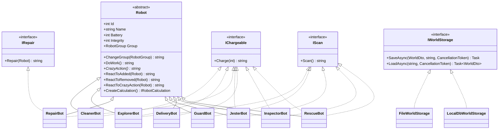
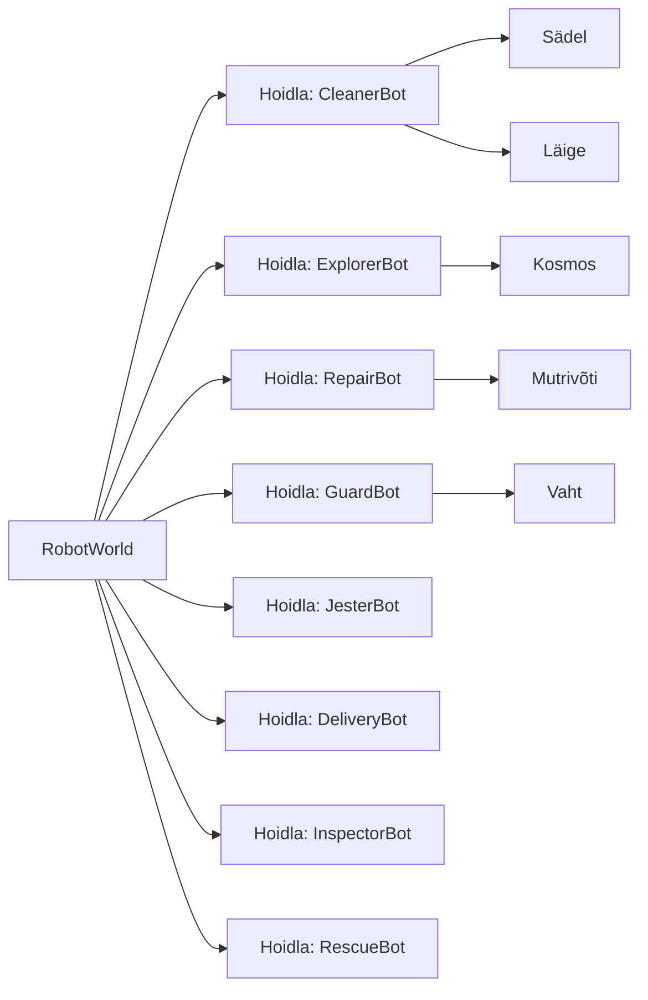
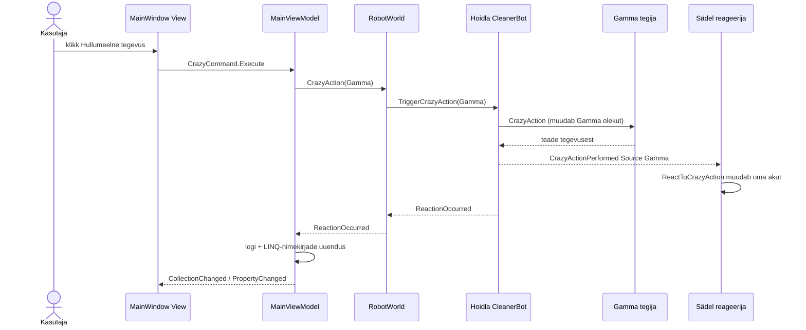
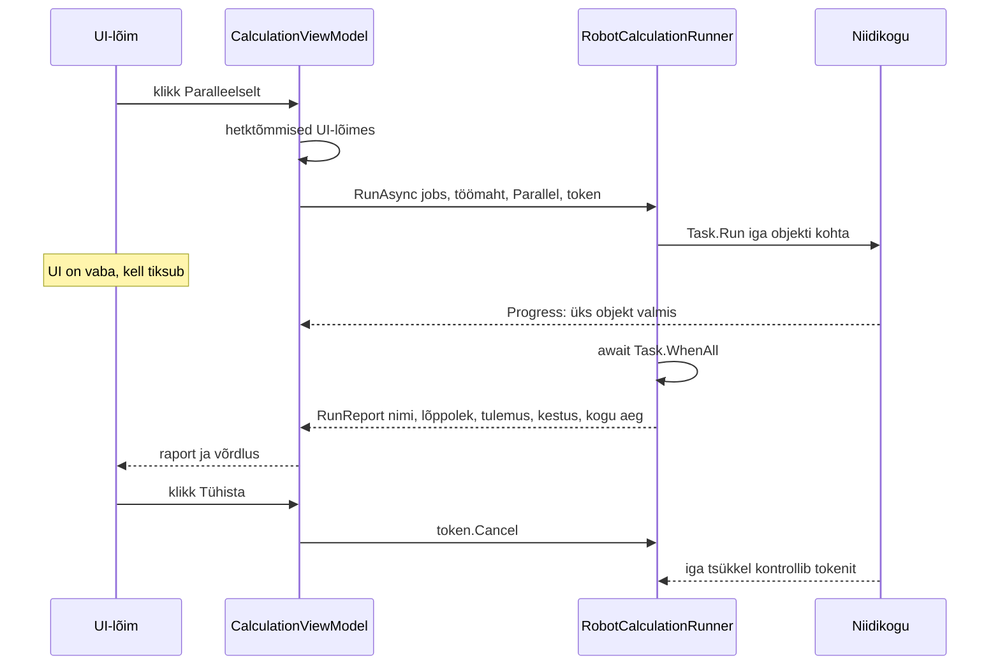

# Robotite planeet (Robot Planet)

WPF-rakendus, kus erinevad robotid elavad samas maailmas, kuid käituvad erinevalt.

* **Vol.1 (Kodutöö 3):** pärilus, liidesed, polümorfism, `CrazyAction()`, kollektsioon.
* **Vol.2 (Kodutöö 4):** tüübipõhised hoidlad (generics), sündmused ja naabrite reaktsioonid, LINQ-päringud ja kohustuslik MVVM.
* **Vol.3 (Ülesanne 5-1):** ressursimahukad CPU-arvutused järjestikku ja paralleelselt (`Task.Run` + `Task.WhenAll`), hetktõmmis, tühistamine (`CancellationToken`), vea- ja tühistuskäsitlus ning raport. UI jääb töö ajal reageerivaks.
* **Vol.4 (Ülesanne 6-1):** maailma oleku salvestamine ja taastamine (DTO-d, JSON, XML, LocalDB/ADO.NET), sõltuvuste süstimine (DI), failidialoogiteenus, rühmade haldus ning tehinguline andmebaasipüsivus.

Sama maailm ja samad tegelased kasvavad edasi: uut universumit ega uut projekti ei loodud.

## Sisukord

1. [Valitud maailm ja rakenduse eesmärk](#1-valitud-maailm-ja-rakenduse-eesmärk)
2. [Käivitamisjuhend](#2-käivitamisjuhend)
3. [Projekti struktuur](#3-projekti-struktuur)
4. [Klassihierarhia ja liidesed](#4-klassihierarhia-ja-liidesed)
5. [CrazyAction ja olekureeglid](#5-crazyaction-ja-olekureeglid)
6. [Hoidlad ja generics](#6-hoidlad-ja-generics)
7. [Sündmused ja reaktsioonid](#7-sündmused-ja-reaktsioonid)
8. [LINQ-päringud](#8-linq-päringud)
9. [MVVM: Model, ViewModel, View](#9-mvvm-model-viewmodel-view)
10. [Vol.3: ressursimahukad arvutused](#10-vol3-ressursimahukad-arvutused)
11. [Vol.3 lühike käivitusjuhend ja demo](#11-vol3-lühike-käivitusjuhend-ja-demo)
12. [Vol.4: salvestamine (DTO, JSON, XML, LocalDB/ADO.NET, DI)](#12-vol4-salvestamine-dto-json-xml-localdbadonet-di)
13. [Vol.4 käivitusjuhend (sh LocalDB) ja demo](#13-vol4-käivitusjuhend-sh-localdb-ja-demo)
14. [Kasutajaliides](#14-kasutajaliides)
15. [Iseseisvalt õpitud WPF UI elemendid](#15-iseseisvalt-õpitud-wpf-ui-elemendid)
16. [Kontrollitud kasutusjuhud](#16-kontrollitud-kasutusjuhud)
17. [Git-koostöö](#17-git-koostöö)
18. [Esitamine](#18-esitamine)
19. [AI kasutamine](#19-ai-kasutamine)

---

## 1. Valitud maailm ja rakenduse eesmärk

Valitud maailm: **ROBOT PLANET**. Planeedil elavad kaheksa tüüpi roboteid: `CleanerBot`, `ExplorerBot`, `RepairBot`, `GuardBot`, `JesterBot`, `DeliveryBot`, `InspectorBot` ja `RescueBot`. Neil on ühine baastüüp `Robot` (aku, terviklikkus ja rühmakuuluvus `RobotGroup`), kuid igaühel on oma tavaline tegevus, oma võimed (liidesed) ja oma hullumeelne tegevus `CrazyAction()`.

**Praktikumi garaaži põhimõte (Vol.2):** iga robotitüüp saab oma hoidla ning selles olevad robotid reageerivad üksteise tegevusele. Näiteks kui üks `CleanerBot` küürib end värvist puhtaks, koristavad teised `CleanerBot`-id tema segaduse ära. `ExplorerBot`-id seda ei märka, sest nad elavad teises hoidlas.

Kõik domeenireeglid (robotid, rühmad, hoidlad, sündmused, reaktsioonid, DTO-d, salvestusteenused) asuvad Core-projektis. WPF-projekt ainult seadistab DI, juhib ja kuvab.

## 2. Käivitamisjuhend

**Nõuded:** Windows 10/11, .NET 10 SDK, Visual Studio töökoormusega *.NET desktop development* (LocalDB režiimi jaoks ka töökoormus *Data storage and processing* või SQL Server Express LocalDB).

```bash
git clone <REPOSITORY-URL>
cd RobotPlanet
git checkout vol4/persistence
dotnet run --project RobotPlanet.Wpf -c Release
```

Alternatiiv: ava `RobotPlanet.slnx` Visual Studios, määra `RobotPlanet.Wpf` käivitusprojektiks ja vajuta **F5**.

* Vaikimisi käivitub rakendus failipõhise salvestusega (`FileWorldStorage`, mis toetab `.json` ja `.xml` faile).
* LocalDB režiimis käivitamiseks määra `RobotPlanet.Wpf/appsettings.json` failis `"Storage": "LocalDb"` või käivita argumendiga:
  ```bash
  dotnet run --project RobotPlanet.Wpf -c Release -- --storage=LocalDb
  ```
* Kiirenemise nägemiseks (Vol.3) käivita **Release**-konfiguratsioonis (Visual Studios vali *Release* ja vajuta **Ctrl+F5**). Varasemad tööd asuvad harudes `vol2/events-linq-mvvm` ja `vol3/parallel-cpu`.

**Demoandmed** (lisatakse käivitamisel teenusest `DemoWorld`):

| ID | Nimi | Tüüp | Aku | Terviklikkus | Vaikerühm |
|---|---|---|---|---|---|
| 1 | Sädel | CleanerBot | 100 | 100 | Alfa |
| 2 | Läige | CleanerBot | 100 | 100 | Alfa |
| 3 | Kosmos | ExplorerBot | 80 | 100 | Alfa |
| 4 | Mutrivõti | RepairBot | 100 | 60 | Alfa |
| 5 | Vaht | GuardBot | 100 | 100 | Alfa |
| *(lisaks partneri tüübid)* | *(Jester, Delivery, Inspector, Rescue)* | — | — | — | Alfa |

## 3. Projekti struktuur

```
RobotPlanet.slnx
├── database.sql                     valikuline SQL-skript (LocalDB tabelid loodakse ka automaatselt)
├── RobotPlanet.Core                 MODEL (klassiteek, ei sõltu WPF-ist ega SQL-pakettidest)
│   ├── entities/                    Robot, RobotGroup (Alfa, Beeta, Gamma), CleanerBot,
│   │                                ExplorerBot, RepairBot, GuardBot, JesterBot, DeliveryBot,
│   │                                InspectorBot, RescueBot
│   ├── interface/                   IChargeable, IScan, IRepair, IRepository<T>, IRobotRepository
│   ├── events/                      RobotEventKind, RobotEventArgs, ReactionEventArgs
│   ├── repository/                  Repository<T>, Repository.Restore.cs (vaikne taastamine)
│   ├── computation/                 RobotSnapshot, RobotCalculations, RobotCalculationRunner (Vol.3)
│   ├── storage/                     WorldDto, RobotDto, IWorldStorage, WorldStorageException, (Vol.4)
│   │                                FileWorldStorage (JSON + XML), LocalDbSql, LocalDbWorldStorage
│   ├── RobotKind.cs                 roboti tüüpide loend
│   ├── RobotWorld.cs                hoidlate register + domeenireeglid
│   ├── RobotWorld.Persistence.cs    CreateDto() ja TryLoad() (atomaarne maailma taastamine) (Vol.4)
│   └── Properties/Resources.resx    teated (eesti keeles, sh laadimise ja andmebaasi teated)
└── RobotPlanet.Wpf                  VIEWMODEL + VIEW (viitab Core-projektile)
    ├── Services/                    IFileDialogService, WpfFileDialogService, DemoWorld, AppSettings (Vol.4)
    ├── ViewModels/
    │   ├── ViewModelBase.cs         INotifyPropertyChanged
    │   ├── RelayCommand.cs          ICommand + CanExecute
    │   ├── MainViewModel.cs         valik, käsud (sh Salvesta, Laadi, Muuda rühma), LINQ, logi
    │   ├── ViewModelTypes.cs        SortChoice, GroupSummary, RepositoryItem
    │   ├── CalculationViewModel.cs  arvutuste valik, käsud, tühistamine, raportid (Vol.3)
    │   └── CalculationParts.cs      CalculationTarget, OutcomeRow, ModeReportViewModel
    ├── App.xaml                     rakenduse ressursid (StartupUri eemaldatud)
    ├── App.xaml.cs                  DI-konteiner (ServiceCollection), salvestusteenuse valik ja käivitus
    ├── appsettings.json             salvestusviisi ("File" / "LocalDb") ja ühendusstringi seadistus
    ├── MainWindow.xaml              VIEW: neli lehte (TabControl), salvestusriba, logi (Expander)
    ├── MainWindow.xaml.cs           ainult paigutus (kitsal ekraanil), ViewModel tuleb konstruktorist
    └── Properties/Resources.resx    kasutajaliidese tekstid
```

## 4. Klassihierarhia ja liidesed



### Klassid

| Klass | Liidesed | `DoWork()` (tavaline tegevus) | `CrazyAction()` |
|---|---|---|---|
| `CleanerBot` | `IChargeable` | koristab põrandat, −5 akut | küürib end puhtaks, pesi värvi maha: −15 akut, −10 terviklikkust |
| `ExplorerBot` | `IChargeable`, `IScan` | uurib ümbrust, −10 akut | avastab "uue planeedi", mis on tema enda vari: −20 akut |
| `RepairBot` | `IChargeable`, `IRepair` | ootab katkiseid (olek ei muutu) | parandab kõike järjest: −10 akut, −5 terviklikkust |
| `GuardBot` | `IScan` | patrullib (olek ei muutu) | arreteerib oma varju: −5 terviklikkust |
| `JesterBot` | `IChargeable`, `IScan` | teeb nalja, −8 akut | etendab liiga hoogsalt: −20 akut |
| `DeliveryBot` | `IChargeable` | toimetab pakke, −5 akut | veab pakke liiga kiiresti: −10 akut, −5 terviklikkust |
| `InspectorBot` | `IChargeable`, `IScan` | kontrollib objekte, −5 akut | inspekteerib kõike korraga: −10 akut, −5 terviklikkust |
| `RescueBot` | `IChargeable`, `IScan` | valmistub päästeks, −7 akut | ryhib päästma kõiki: −12 akut, −8 terviklikkust |

`ExplorerBot`, `RepairBot`, `JesterBot`, `InspectorBot` ja `RescueBot` täidavad kaht rolli korraga (kaks liidest).

### Liidesed

| Liides | Meetod | Kirjeldus |
|---|---|---|
| `IChargeable` | `string Charge(int amount)` | roboti akut saab laadida |
| `IScan` | `string Scan()` | robot oskab ümbrust skaneerida |
| `IRepair` | `string Repair(Robot target)` | robot oskab teist robotit parandada |
| `IRepository<T>` | `Add`, `Remove`, `GetAll`, `Find` | tüübipõhine hoidla (vt punkt 6) |
| `IRobotRepository` | `Title`, `Count`, `Robots` | hoidla kirjutuskaitstud vaade registrile ja UI-le |
| `IWorldStorage` | `SaveAsync`, `LoadAsync` | maailma DTO salvestamine ja lugemine (JSON/XML või LocalDB) (Vol.4) |
| `IFileDialogService` | `PickSaveFile`, `PickOpenFile` | eraldab failidialoogi ViewModelist (Vol.4) |

`GuardBot` ei ole laetav (tal on reaktor). See on teadlik valik, et võimete kontroll `is` / `as` operaatoriga annaks tüüpide vahel päris erineva tulemuse.

### Polümorfism ja võimete kontroll

* `DoWork()` on `virtual`, `CrazyAction()` on `abstract`. Alamklassid muudavad neid `override` abil.
* Samamoodi on `ReactToAdded`, `ReactToRemoved` ja `ReactToCrazyAction` `virtual` meetodid: iga tüüp võib reageerida omamoodi.
* `CreateCalculation()` on samuti `virtual`: iga tüüp valib oma CPU-arvutuse (vt punkt 10), vaikimisi saab uus tüüp üldise arenguprognoosi.
* Käitumist **ei valita** tüübipõhise `if` / `switch` plokiga. Hoidla ja ViewModel kutsuvad meetodeid baastüübi `Robot` kaudu.
* `RobotWorld` ja ViewModel kontrollivad võimeid operaatoritega `is` ja `as` (`robot is IChargeable`, `robot as IScan`, `healer is IRepair`).

## 5. CrazyAction ja olekureeglid

### CrazyAction tegevused

| Robot | Tingimus | Tulemus |
|---|---|---|
| `CleanerBot` | aku < 15 | keeldub, olek ei muutu |
| `CleanerBot` | aku ≥ 15 | aku −15, terviklikkus −10 |
| `ExplorerBot` | aku < 20 | keeldub, olek ei muutu |
| `ExplorerBot` | aku ≥ 20 | aku −20 |
| `RepairBot` | terviklikkus < 20 | laguneb ise koost, keeldub |
| `RepairBot` | aku < 10 | keeldub, olek ei muutu |
| `RepairBot` | muidu | aku −10, terviklikkus −5 |
| `GuardBot` | terviklikkus < 30 | jääb vahipostil magama, olek ei muutu |
| `GuardBot` | muidu | terviklikkus −5 |
| `JesterBot` | aku < 20 | keeldub, olek ei muutu |
| `JesterBot` | aku ≥ 20 | aku −20 |
| `DeliveryBot` | terviklikkus < 20 | keeldub (liiga katki), olek ei muutu |
| `DeliveryBot` | aku < 10 | keeldub, olek ei muutu |
| `DeliveryBot` | muidu | aku −10, terviklikkus −5 |
| `InspectorBot` | terviklikkus < 20 | keeldub (liiga katki), olek ei muutu |
| `InspectorBot` | aku < 10 | keeldub, olek ei muutu |
| `InspectorBot` | muidu | aku −10, terviklikkus −5 |
| `RescueBot` | terviklikkus < 23 | keeldub (liiga katki), olek ei muutu |
| `RescueBot` | aku < 12 | keeldub, olek ei muutu |
| `RescueBot` | muidu | aku −12, terviklikkus −8 |

### Olekureeglid ja valideerimine

* **Identiteet** (`Id`, `Name`) määratakse konstruktoris ja on ainult loetav.
* `Id`: 0–999999 ja **unikaalne kogu maailmas** (kontrollib `RobotWorld.TryAdd`, ka teise tüübi robotite vastu).
* `Name`: pärast `Trim()` 2–20 märki, mitte tühi.
* `Battery` ja `Integrity`: 0–100. Setter on `private`, muutmine käib ainult kaitstud meetoditega `TrySpendBattery`, `TryAddBattery`, `TryDamage`, `TryRestoreIntegrity`.
* **Rühmakuuluvus (`Group`):** `RobotGroup` (`Alfa`, `Beeta`, `Gamma`), vaikimisi `Alfa`. Muutmine käib meetodiga `ChangeGroup(RobotGroup)`, mis kontrollib `Enum.IsDefined`, teavitab UI-d (`INotifyPropertyChanged`) ja salvestatakse koos roboti olekuga.
* Need meetodid **keelduvad vigasest sisendist ja ei muuda olekut** (negatiivne kogus, liiga vähe akut, tundmatu rühm).
* `ReceiveRepair(int)` on ainus avalik remondisisend: kogus 1–100, ideaalses seisus robotit ei paranda.
* Vigane konstruktoriargument annab `ArgumentException`, mille `RobotWorld.TryAdd` ja `RobotWorld.TryLoad` püüavad kinni ja tagastavad sõnumina. Rakendus ei sulgu.
* Tekstisisend muudetakse arvuks ViewModelis (`int.TryParse`), ülejäänud reeglid kontrollib Core.

## 6. Hoidlad ja generics

```csharp
public interface IRepository<T> where T : Robot
{
    void Add(T item);
    bool Remove(T item);
    IEnumerable<T> GetAll();
    T? Find(Func<T, bool> predicate);
}

public partial class Repository<T> : IRepository<T>, IRobotRepository where T : Robot
```

* **Iga konkreetse tüübi jaoks eraldi hoidla:** `Repository<CleanerBot>`, `Repository<ExplorerBot>`, `Repository<RepairBot>`, `Repository<GuardBot>` jne. Hoidlad on loodud selle maailma enda klassidest.
* **Piirang `where T : Robot`** tuleneb maailma olemasolevast ühisest baastüübist. Vale tüübi lisamist takistab **kompilaator**, mitte nimede võrdlemine kasutajaliideses:

  | Katse | Kompilaatori vastus |
  |---|---|
  | `new Repository<string>()` | `CS0311`: `string` ei ole `Robot` |
  | `Repository<CleanerBot>.Add(new GuardBot(...))` | `CS1503`: `GuardBot` ei ole `CleanerBot` |

* `Repository<T>` hoiab robotid `ObservableCollection<T>`-is ja annab UI-le välja kirjutuskaitstud `ReadOnlyObservableCollection<T>` (`Items`). UI ei saa roboteid otse lisada ega eemaldada.
* `RobotWorld` on hoidlate **register**. Konstruktoris on iga tüübi kohta üks rida:

  ```csharp
  Register(RobotKind.Cleaner, (id, name, battery, integrity) => new CleanerBot(id, name, battery, integrity));
  ```

  Uue tüübi lisamiseks piisab uuest klassist, uuest `RobotKind` väärtusest ja ühest `Register`-reast. Hoidla, sündmused, tellimused, UI-kuvamine ning ka JSON/XML/LocalDB salvestus ja taastamine toimivad automaatselt.
* `RobotWorld` leiab roboti hoidla **täpse tüübi** järgi (`GetType() == typeof(T)`), seega robot ei satu kunagi teise tüübi hoidlasse.



Sama hoidla robotid kuulavad üksteist. Eri hoidlate robotid ei kuule üksteist.

## 7. Sündmused ja reaktsioonid

Sündmused ja reaktsioonid kuuluvad **domeeniloogikasse (Core)**, mitte WPF-nupu sündmuskäsitleja sisse.

### Kolm sündmust (`Repository<T>`)

| Sündmus | Millal | Kes reageerib |
|---|---|---|
| `ItemAdded` | hoidlasse lisatakse robot | kõik **senised** selle hoidla robotid tervitavad uut tulijat; uus robot ei tervita iseennast |
| `ItemRemoved` | robot eemaldatakse hoidlast | allesjäänud robotid reageerivad lahkumisele; eemaldatud robot enam ei reageeri |
| `CrazyActionPerformed` | robot teeb oma `CrazyAction()` | teised sama hoidla robotid reageerivad; tegevuse põhjustaja ei reageeri iseendale |

Iga sündmus kannab `RobotEventArgs`: `Source` (milline robot tegevuse põhjustas) ja `Kind` (mis juhtus). Iga reaktsioon jätab logikirje: hoidla tõstab `ReactionOccurred` (`ReactionEventArgs` koos reageerija, põhjuse ja sõnumiga).

### Tellimuste haldus

* `Add`: robot lisatakse kollektsiooni ja **tellitakse** kõigile kolmele sündmusele.
* `Remove`: robot **tühistab** kõik kolm tellimust enne, kui `ItemRemoved` tõstetakse. Seetõttu ei reageeri eemaldatud robot ei oma lahkumisele ega hilisematele sündmustele.
* `Restore` ja `ClearSilently` (Vol.4): failist või andmebaasist maailma taastamisel tühistatakse vanade robotite tellimused ning uued robotid lisatakse hoidlasse **ilma tervitusreaktsioone käivitamata** (nii ei kuluta nt `ExplorerBot` laadimisel akut ja olek jääb täpselt salvestatuks). Pärast taastamist on kõik kolm sündmusetellimust aktiivsed.
* `React(...)` jätab sündmuse vahele, kui `e.Source` on reageerija ise.
* Tellimuste hoidmiseks on `Dictionary<T, Subscription>`, et sama delegaadi saaks hiljem tühistada.

### Reaktsioonid (igal tüübil oma)

| Robot | Sündmus | Reaktsioon | Muudab reageerija olekut? |
|---|---|---|---|
| kõik (vaikimisi) | lisamine / eemaldamine / CrazyAction | teade, et robot tervitab / vaatab kurvalt / vaatab pealt | ei |
| `CleanerBot` | CrazyAction | koristab teise tekitatud segaduse ära | **jah:** aku −3 (liiga väsinuna ei korista) |
| `ExplorerBot` | lisamine | asub uurima tulijat | **jah:** aku −2 (liiga väsinuna ei uuri) |
| `ExplorerBot` | eemaldamine | märgib kaardile, et robot on kadunud | ei |
| `RepairBot` | CrazyAction | märkab pahandust ja lappab end | **jah:** terviklikkus +3 (kuni 100) |
| `RepairBot` | eemaldamine | kogub lahkunu varuosad | ei |
| `GuardBot` | lisamine | kontrollib tulija ID-d | ei |
| `GuardBot` | CrazyAction | nõuab tegijalt seletust | ei |
| `DeliveryBot` | CrazyAction | märkab pahandust ja parandab end | **jah:** terviklikkus +3 (kuni 100) |
| `DeliveryBot` | eemaldamine | märgib lahkunu kohaletoimetuse nimekirjast | ei |
| `InspectorBot` | CrazyAction | kontrollib tegija tegevust ja parandab end | **jah:** terviklikkus +3 (kuni 100) |
| `InspectorBot` | eemaldamine | kirjutab lahkumise kohta aruande | ei |
| `RescueBot` | CrazyAction | tõttab appi ja parandab end | **jah:** terviklikkus +6 (kuni 100) |
| `RescueBot` | eemaldamine | märgib lahkunu päästenimekirja | ei |

Vähemalt kolm reaktsiooni muudavad reageerija olekut (aku või terviklikkus).

### Ühe sündmuse teekond (näide: `Gamma` teeb `CrazyAction()`)



Sammud sõnadega:

1. **View:** nupp on seotud käsuga `CrazyCommand` (`Command="{Binding CrazyCommand}"`), koodis pole `Click`-sündmust.
2. **ViewModel:** `RelayCommand` käivitab `Crazy()`, mis läheb läbi `Run(...)`.
3. **Model:** `RobotWorld` leiab roboti hoidla ja kutsub `Repository<T>.TriggerCrazyAction(actor)`.
4. Hoidla kutsub polümorfselt `actor.CrazyAction()` (muudab tegija olekut) ja tõstab `CrazyActionPerformed`.
5. Iga tellitud robot (v.a tegija) käivitab oma `ReactToCrazyAction(...)`, mis võib muuta tema enda olekut, ja hoidla tõstab `ReactionOccurred`.
6. `RobotWorld` edastab reaktsiooni ühe sündmusena. ViewModel kogub selle tegevuse sõnumi alla.
7. `Run` kirjutab logisse esmalt tegevuse rea ja selle alla reaktsioonid (`↳`), seejärel uuendab LINQ-nimekirjad, kokkuvõtte ja käskude `CanExecute`.
8. `Robot` teavitab oleku muutusest (`INotifyPropertyChanged`), seega aku- ja terviklikkuseribad uuenevad ise.

## 8. LINQ-päringud

Kolm päringut asuvad `MainViewModel`-is ja nende tulemused kuvatakse kasutajaliideses:

| Päring | Operaator | Kus UI-s | Kood |
|---|---|---|---|
| **Otsimine** | `Where` | otsinguväli "Otsi nime või ID järgi" | `query.Where(r => r.Name.Contains(text, StringComparison.CurrentCultureIgnoreCase) \|\| r.Id.ToString().Contains(text))` |
| **Sorteerimine** | `OrderBy` / `OrderByDescending` | valik "Sorteeri" (nimi, aku, terviklikkus, ID) ja märkeruut "Kahanevalt" | `SortDescending ? query.OrderByDescending(r => r.Battery) : query.OrderBy(r => r.Battery)` |
| **Grupeerimine** | `GroupBy` | kaart "Kokkuvõte" | `_world.Robots.GroupBy(r => r.Kind).Select(g => new GroupSummary(g.Key, g.Count(), (int)Math.Round(g.Average(r => r.Battery)), (int)Math.Round(g.Average(r => r.Integrity))))` |

* Otsing ja sorteerimine töötavad valitud hoidla robotitel (`VisibleRobots`).
* Kokkuvõte ühendab kõigi hoidlate lugemisvaated (`RobotWorld.Robots`) ja näitab iga tüübi robotite arvu ning keskmist akut ja terviklikkust.
* Pärast iga tegevust ja pärast maailma laadimist arvutatakse päringud uuesti, seega nimekiri ja kokkuvõte uuenevad automaatselt.
* Nimekirja uuendab `Sync(...)` meetod (`Remove` / `Move` / `Insert`, mitte `Clear` + `Add`), et valitud robot jääks valituks.

## 9. MVVM: Model, ViewModel, View

| Kiht | Vastutus | Kus |
|---|---|---|
| **Model (Core)** | robotid, rühmad, hoidlad, sündmused, reaktsioonid, valideerimine, DTO-d, faili- ja LocalDB-salvestus. Ei sõltu WPF-ist | `RobotPlanet.Core` |
| **ViewModel** | valitud hoidla ja robot, rühmavalik, kuvatavad loendid, LINQ-päringud, logi, kasutaja käsud (`ICommand`), salvestamise ja laadimise koordineerimine | `RobotPlanet.Wpf/ViewModels` |
| **View + käivitus** | ainult kujundus ja sidumised (`Binding`). `App.xaml.cs` seadistab DI ja teenused (`IWorldStorage`, `IFileDialogService`) | `MainWindow.xaml`, `App.xaml.cs`, `Services` |

### Käsud ja `CanExecute`

Tegevused käivitatakse `ICommand`-käskudega (`RelayCommand`). `CanExecute` keelab käsu (nupp tuhmub), kui sobivat valikut või vajalikku sisendit pole:

| Käsk | Lubatud, kui |
|---|---|
| `WorkCommand`, `CrazyCommand`, `RemoveCommand` | on valitud robot |
| `ChangeGroupCommand` (Vol.4) | on valitud robot ja rühm, ning ei käi salvestamine/laadimine |
| `ChargeCommand` | valitud robot `is IChargeable` |
| `ScanCommand` | valitud robot `is IScan` |
| `RepairCommand` | valitud robot `is IRepair` ja on valitud sihtmärk |
| `AddCommand` | on valitud tüüp ning ID ja nimi pole tühjad |
| `SaveCommand` (Vol.4) | ei käi salvestamine/laadimine |
| `LoadCommand` (Vol.4) | ei käi salvestamine/laadimine ega Vol.3 CPU-arvutus |
| `ClearLogCommand` | alati |
| `RunSequentialCommand`, `RunParallelCommand`, `RunBothCommand` (Vol.3) | on valitud vähemalt üks objekt ja töö ei käi |
| `CancelCommand` (Vol.3) | töö käib ja tühistamist pole veel küsitud |
| `SelectAllCommand`, `ClearSelectionCommand` (Vol.3) | töö ei käi |

Vol.3 käsud asuvad eraldi alam-ViewModelis `CalculationViewModel`, mida `MainViewModel` annab välja omadusena `Calculation`. Nii jääb `MainViewModel` väikeseks.

### Automaatsed uuendused

* **Loend:** `ObservableCollection<T>` / `ReadOnlyObservableCollection<T>` (`CollectionChanged`).
* **Roboti olek ja rühm:** `Robot` realiseerib `INotifyPropertyChanged` (liides on .NET baasteegist, mitte WPF-ist, seega Core ei sõltu WPF-ist).
* **Kokkuvõte ja logi:** `Run(...)` ja `LoadAsync()` uuendavad need pärast iga tegevust või laadimist.
* **Käskude lubatavus:** ViewModel kutsub `RaiseCanExecuteChanged()` valiku, sisendi, salvestamise/laadimise ja arvutuste oleku muutudes.
* **UI-koodis puudub** hoidlate, failivormingu ega andmebaasi äriloogika: kood-taga ei sisalda `Click`-käsitlejaid ega `_world` viiteid.

## 10. Vol.3: ressursimahukad arvutused

Vol.3 lisab samasse projekti ja hoidlasse **CPU-mahukad arvutused**. Kasutaja valib objektid ja töömahu, arvutused käivitatakse **järjestikku** ja **paralleelselt** samal sisendil, UI jääb töö ajal reageerivaks ning töö saab **tühistada**. Tulemused, vead ja tühistused koondatakse raportisse.

### Objektid ja nende arvutused

Valitud on kõik robotitüübid (nõutud vähemalt kolm). Iga tüüp valib oma arvutuse polümorfselt (`Robot.CreateCalculation()` on `virtual`, ilma `switch`-ita):

| Robot | Arvutus | Mida arvutab | Mida hetktõmmisest kasutab | Tulemus |
|---|---|---|---|---|
| `ExplorerBot` | Retkevariantide võrdlus (`RouteComparisonCalculation`) | võrdleb 300 000 × töömaht juhuslikku retkevarianti läbi 8–13 teekonnapunkti | aku (punktide arv = 8 + aku / 20) | lühima retke pikkus |
| `CleanerBot` | Koristussimulatsioon (`CleaningSimulationCalculation`) | 2 500 × töömaht korduvat juhuslikku koristusrännakut 20×20 ruudustikul, eesmärk 60 % kaetust | aku (sammude piir = aku × 12) | keskmine kaetus (%) |
| `GuardBot` | Patrulli simulatsioon (`PatrolSimulationCalculation`) | 4 000 000 × töömaht tiksu patrulli ringil, sissetungijad ilmuvad juhuslikult | terviklikkus (avastamise tõenäosus) | tuvastatud sissetungijate osa (%) |
| `RepairBot` ja iga uus tüüp (vaikimisi) | Arenguprognoos (`WearForecastCalculation`) | 15 000 × töömaht Monte Carlo prognoosi 200 päeva kohta | aku (kulumise kiirus) ja terviklikkus | tõenäosus, et terviklikkus langeb alla 20 (%) |

**Töömaht** on liugur 1–50 ja see skaleerib iteratsioonide arvu. Vaikimisi töömaht 10 võtab ühe objekti kohta murdosa sekundist kuni umbes poole sekundi, töömaht 50 mitu sekundit (sõltub arvutist ja ehitusest).

Arvutuste ülesehitus on **mall-meetod**: baasklass `RobotCalculation` kontrollib ühist eeltingimust (robot peab olema töökorras) ja alamklass täidab oma algoritmi meetodis `Compute`.

### Hetktõmmis (snapshot)

`RobotSnapshot` on muutumatu `record` (Id, Name, Kind, Battery, Integrity). Hetktõmmis tehakse **UI-lõimes käivitamise hetkel** (`RobotCalculationJob.From(robot)`). Taustalõimed loevad ainult seda koopiat, mitte elavat `Robot` objekti, mis on seotud kasutajaliidesega ja muutub töö ajal. Mõlemad režiimid kasutavad **samu hetktõmmiseid** ja sama töömahtu.

### Kaks režiimi

```csharp
// Järjestikune: oota ühe objekti lõppu enne järgmise alustamist
foreach (RobotCalculationJob job in jobs)
    outcomes.Add(await Task.Run(() => RunOne(job, workload, token, progress)));

// Paralleelne: käivita kõik korraga Task.Run-iga ja oota kõiki Task.WhenAll-iga
Task<CalculationOutcome>[] tasks = jobs.Select(job => Task.Run(() => RunOne(job, workload, token, progress))).ToArray();
CalculationOutcome[] outcomes = await Task.WhenAll(tasks);
```

* **Sama sisend:** sama hetktõmmiste loend ja sama töömaht. Iga robot kasutab oma `Random`-it seemnega `Id * 7919 + töömaht`, seega tulemus on deterministlik ja kahe režiimi tulemusi saab võrrelda.
* **Aja mõõtmine:** `Stopwatch` mõõdab iga objekti kestuse ja kogu töö aja (`RunReport.TotalDuration`).
* **Võrdlus:** `RunComparison` kontrollib, et sisend oli sama (`SameInput`), kas kõik tulemused ühtivad (`ResultsMatch`) ja arvutab kiirenemise (järjestikune aeg / paralleelne aeg). Tühistatud käivitust ei võrrelda.

### UI jääb reageerivaks

* Arvutus jookseb Core-is `Task.Run`-iga niidikogus. ViewModel kasutab `async`/`await` ning **ei kasuta** `.Result` ega `.Wait()`, seega UI-lõim ei blokeeru.
* Edenemist teatab `Progress<CalculationOutcome>`, mis on loodud UI-lõimes, seega selle tagasikutse jookseb UI-lõimes ja lisab raportisse rea kohe, kui objekt on valmis.
* Elav kell "Kulunud aeg" uuendub `PeriodicTimer`-iga ja näitab, et UI ei ole külmunud.
* `ObservableCollection`-id ja omadused muutuvad ainult UI-lõimes. Taustalõimed puutuvad ainult hetktõmmist.
* Töö ajal on valik ja liugur tuhmid (`CanEdit`), et sisend ei muutuks käivituse keskel.

### Tühistamine

* **Üks ühine `CancellationTokenSource`** kogu käivituse kohta. Nupp **Tühista** kutsub `Cancel()`, mis jõuab kõigi arvutusteni.
* **Iga CPU-tsükkel kontrollib seda:** iga ring (nii välimine kui sisemine) algab `token.ThrowIfCancellationRequested()`-iga. Seetõttu peatub töö kiiresti, ka töömahu 50 puhul.
* Objektid, mille tööd polnud veel alanud (järjestikune režiim), märgitakse tühistatuks **enne alustamist**.
* **Võrdle mõlemat**: kui tühistatakse esimese režiimi ajal, teist režiimi ei alustata.
* Pärast tühistamist saab kohe uue käivituse teha.

### Edu, viga ja tühistus

`RunOne` püüab iga objekti tulemuse kinni ja muudab selle kolmeks lõppolekuks, nii et ükski erand ei välju meetodist:

| Lõppolek | Millal | Raportis |
|---|---|---|
| **Õnnestus** | arvutus lõppes | tulemuse tekst |
| **Viga** | arvutus viskas erandi (nt robot pole töökorras) | veateade; ülejäänud tööd jätkuvad |
| **Tühistatud** | token tühistati | "Tühistati töö ajal." või "Tühistati enne alustamist." |

Kuna iga ülesanne püüab oma erandid kinni, ei viska `Task.WhenAll` kunagi ja ühe objekti viga ei peata teisi.

### Raport

Iga rida: **objekti nimi**, **lõppolek**, **tulemus või veateade**, **kestus**. Raporti lõpus **kogu töö aeg** ja loendurid (Õnnestus / Viga / Tühistatud). Mõlema režiimi raport on eraldi (leht **Raportid**), võrdluskaart on lehel **Arvutused**.



## 11. Vol.3 lühike käivitusjuhend ja demo

```bash
git clone <REPOSITORY-URL>
cd RobotPlanet
git checkout vol3/parallel-cpu
dotnet run --project RobotPlanet.Wpf -c Release
```

Visual Studios: vali *Release*, määra `RobotPlanet.Wpf` käivitusprojektiks ja vajuta **Ctrl+F5**. Vajalik on .NET 10 SDK ja Windows.

Kolm demostsenaariumi (leht **Arvutused**, tulemused lehel **Raportid**):

| Demo | Sammud | Mida näed |
|---|---|---|
| **1. Mõlemad režiimid** | Vajuta **Vali kõik**, töömaht 10, **Võrdle mõlemat** | Lehel **Arvutused** täitub edenemisriba, kell tiksub ja laimikaardil on kiirenemine ning "Tulemused ühtivad: jah". Lehel **Raportid** on kaks raportit (**Järjestikku**, **Paralleelselt**), kõik **Õnnestus** |
| **2. Viga** | Lehel **Haldus** lisa vormis tüüp `Explorer`, nimi `Tühiaku`, aku `0`. Lehel **Arvutused** vali kõik objektid, **Võrdle mõlemat** | Lehel **Raportid** on `Tühiaku` rida punane **Viga** koos veateatega, ülejäänud on **Õnnestus**. Töö lõpeb olekuga "Valmis." |
| **3. Tühistamine** | Töömaht 50, vajuta **Paralleelselt** ja varsti **Tühista** | Lehel **Raportid** muutuvad kõik read halliks **Tühistatud**, lehel **Arvutused** kell peatub, olek "Tühistatud." Uus käivitus töötab normaalselt |

Kiirenemine sõltub protsessori tuumade arvust: mitmetuumalisel arvutil on paralleelne režiim märgatavalt kiirem, ühe tuumaga arvutil on vahe väike.

## 12. Vol.4: salvestamine (DTO, JSON, XML, LocalDB/ADO.NET, DI)

Vol.4 lisab sama maailma, MVVM-i ja `Repository<T>` lahenduse peale maailma oleku püsiva salvestamise ning taastamise nii faili (JSON, XML) kui ka LocalDB relatsioonilisse andmebaasi.

### DTO-d ja domeenimudeli eraldatus

* Maailma ei serialiseerita otse UI- ega domeeniobjektidena (aknad, `ICommand`-id, sündmustellimused ja hoidlad jäävad kõrvale).
* `RobotWorld.CreateDto()` koostab UI-lõimes puhta andmeedastusmudeli `WorldDto` (versioon `1` + `List<RobotDto>`), kus iga `RobotDto` sisaldab omadusi: `Id`, `Type` (`RobotKind`), `Name`, `Battery`, `Integrity` ja `Group` (`RobotGroup`).
* Kõik DTO väljad on nullable (`int?`, `string?`), et vigases failis puuduv väli tuvastataks selge veana, mitte ei asenduks vaikselt nulliga.

### Ohutu laadimine ja reaktsioonide taastamine (`RobotWorld.TryLoad`)

1. `IWorldStorage.LoadAsync(...)` loeb andmed (JSON, XML või SQL) `WorldDto` kujule ja edastab selle `RobotWorld.TryLoad(dto, out message)` meetodile.
2. **Eelkontroll enne muutmist:** kontrollitakse andmeversiooni, kohustuslike väljade olemasolu, roboti tüüpi (`RobotKind`), rühma (`RobotGroup`), konstruktori äriloogika reegleid (`Id` vahemik, nime pikkus, `Battery`/`Integrity` 0–100) ning ID-de unikaalsust kogu failis.
3. **Atomaarne asendus:** alles siis, kui **kõik** kirjed on kehtivad, tühjendatakse vanad hoidlad (`ClearSilently` tühistab vanade robotite sündmustellimused) ja luuakse õiged robotitüübid vastavatesse `Repository<T>` hoidlatesse (`Restore`).
4. Kui fail või andmebaas on vigane, jääb senine maailm täielikult muutmata, ühtegi sündmust ei käivitata ning logisse kuvatakse täpne põhjus koos reaga *"Senine maailm jäi muutmata."*
5. Taastatud maailmas on kõik sündmustellimused aktiivsed, kuid laadimise enda ajal naabrite tervitusreaktsioone ei käivitata (et seis vastaks täpselt salvestatule).

### Salvestusteenused (`IWorldStorage`)

```csharp
public interface IWorldStorage
{
    Task SaveAsync(WorldDto world, string path, CancellationToken token = default);
    Task<WorldDto> LoadAsync(string path, CancellationToken token = default);
}
```

* **`FileWorldStorage` (JSON ja XML):**
  * Valib vormingu faililaiendi järgi (`.json` → `System.Text.Json`, `.xml` → `System.Xml.Serialization.XmlSerializer`, kus DTD on turvalisuse huvides keelatud `DtdProcessing.Prohibit`).
  * Kirjutamine on atomaarne: esmalt kirjutatakse ajutisse faili (`*.tmp`) ja alles õnnestumise korral asendatakse sihtfail (`File.Move(..., overwrite: true)`), et katkenud salvestus ei rikuks olemasolevat faili.
  * JSON näide:
    ```json
    {
      "version": 1,
      "robots": [
        { "id": 1, "type": "Cleaner", "name": "Sädel", "battery": 100, "integrity": 100, "group": "Alfa" }
      ]
    }
    ```
* **`LocalDbWorldStorage` (LocalDB ja ADO.NET):**
  * Kasutab ainult `System.Data.Common` abstraktsioone (`DbConnection`, `DbTransaction`, `DbCommand`), seega `RobotPlanet.Core` jääb ilma välistest NuGet-pakettidest. Tegeliku `SqlConnection`-i tehase (`Microsoft.Data.SqlClient`) annab `App.xaml.cs` DI kaudu.
  * **Andmebaasi skeem** (luuakse esmakordsel pöördumisel automaatselt või skriptist `database.sql`):
    * `RobotGroups` (`Id INT PRIMARY KEY`, `Name NVARCHAR(32) NOT NULL UNIQUE`) — rühmad `Alfa`, `Beeta`, `Gamma`.
    * `Robots` (`Id INT PRIMARY KEY`, `Position INT NOT NULL`, `Type NVARCHAR(32) NOT NULL`, `Name NVARCHAR(64) NOT NULL`, `Battery INT NOT NULL CHECK (Battery BETWEEN 0 AND 100)`, `Integrity INT NOT NULL CHECK (Integrity BETWEEN 0 AND 100)`, `GroupId INT NOT NULL FOREIGN KEY REFERENCES RobotGroups(Id)`) — välisvõti seob roboti rühmaga ja `Position` säilitab järjekorra.
    * `WorldInfo` (`Id INT PRIMARY KEY`, `Version INT NOT NULL`) — andmeskeemi versioon.
  * **Parametriseeritud SQL ja üks tehing:** kõik väärtused edastatakse SQL-parameetritena (`@Id`, `@Name`, `@GroupId` jne), et välistada SQL-süstimine. Kogu salvestus (`DELETE` vanad kirjed + `INSERT` rühmad ja robotid + `WorldInfo`) toimub **ühes `DbTransaction` tehingus** — mistahes vea korral teeb `RollbackAsync()` muudatused tagasi ja eelmine maailm andmebaasis jääb terveks.

### Sõltuvuste süstimine (DI) ja dialoogiteenus

* `MainViewModel` ei loo salvestusteenust ega dialooge ise, vaid võtab konstruktoris vastu liidesed `(RobotWorld, IWorldStorage, IFileDialogService, ...)`.
* `App.xaml.cs` ehitab `Microsoft.Extensions.DependencyInjection` konteineri, loeb `appsettings.json`-i ja käsurea argumendid (`AppSettings`) ning registreerib vastava `IWorldStorage` teostuse (`FileWorldStorage` või `LocalDbWorldStorage`).
* Faili asukoha valib `WpfFileDialogService` (`IFileDialogService`); `MainViewModel` saab tagasi ainult failitee stringi ja edastab selle `IWorldStorage`-ile. LocalDB režiimis failidialoogi ei avata ning ülaribal kuvatakse valitud DI-teostus: **`Salvestusteenus: FileWorldStorage`** või **`Salvestusteenus: LocalDbWorldStorage`**.

## 13. Vol.4 käivitusjuhend (sh LocalDB) ja demo

### LocalDB eeldused ja seadistamine

1. **Eeldused:** Windows ning paigaldatud SQL Server Express LocalDB (Visual Studio Installeris komponent *Data storage and processing*).
2. **Eksemplari kontroll:** käsureal `sqllocaldb info` peab kuvama `MSSQLLocalDB`. Vajadusel käivita see käsuga:
   ```bash
   sqllocaldb start MSSQLLocalDB
   ```
3. **Ühendusstring (`RobotPlanet.Wpf/appsettings.json`):**
   ```json
   {
     "Storage": "LocalDb",
     "ConnectionStrings": {
       "RobotPlanet": "Server=(localdb)\\MSSQLLocalDB;Database=RobotPlanet;Integrated Security=true;TrustServerCertificate=true;"
     }
   }
   ```
   *(Märkus: `TrustServerCertificate=true` on vajalik, sest `Microsoft.Data.SqlClient` kasutab vaikimisi krüpteeritud ühendust.)*
4. **Andmebaasi ja tabelite loomine:**
   * **Automaatselt (vaikimisi):** rakendus ühendub esimesel `Salvesta` või `Laadi` vajutusel süsteemibaasiga `master`, loob andmebaasi `RobotPlanet` (kui see puudub) ja käivitab idempotentse tabelite loomise skripti. Esimene käivitus võib võtta paar sekundit, kuni LocalDB eksemplar ärkab.
   * **Käsitsi (valikuline):** skripti saab käivitada ka käsuga `sqlcmd -S "(localdb)\MSSQLLocalDB" -i database.sql` ning tabeleid vaadata Visual Studios (*View → SQL Server Object Explorer*).
5. **Režiimi vahetamine käivitamisel (DI):** muuda `appsettings.json`-is `"Storage"` väärtuseks `"File"` või `"LocalDb"`, või anna käsurealt `--storage=LocalDb` (Visual Studios: *Project Properties → Debug → General → Open debug launch profiles UI → Command line arguments*).

### Demo stsenaarium (Vol.4 slaidi järgi)

| Samm | Tegevus | Oodatud tulemus |
|---|---|---|
| **1. Muuda maailma ja salvesta faili** | Käivita rakendus (`Storage: File`, ülaribal `Salvestusteenus: FileWorldStorage`). Lisa uus robot, tee mõnele robotile **Hullumeelne tegevus!** (olek muutub) ja muuda valitud roboti rühma (**Rühm → Beeta → Muuda rühma**). Vajuta **Salvesta** ja salvesta maailm nii `.json` kui ka `.xml` faili. | Logis kinnitused salvestatud tegelaste arvuga; mõlemad failid luuakse kettale. |
| **2. Taaskäivita ja laadi** | Sulge rakendus. Käivita uuesti (taastuvad algandmed), vajuta **Laadi** ja vali `.json` fail. Muuda maailma ja laadi seejärel `.xml` fail. | Taastuvad täpselt samad ID-d, tüübid, nimed, aku/terviklikkuse väärtused ja rühmad (`Beeta`). Kokkuvõtte ja arvutuste nimekirjad uuenevad. |
| **3. CrazyAction pärast laadimist** | Vali taastatud maailmas `CleanerBot` ja vajuta **Hullumeelne tegevus!** | Tegija olek muutub ja sama hoidla teised `CleanerBot`-id reageerivad (aku väheneb, logis `↳` reaktsioonid, UI ribad liiguvad). |
| **4. Vigane fail** | Vajuta **Laadi** ja vali vigane fail (nt katkine JSON, tundmatu tüüp või `.txt` fail). | Logis kuvatakse arusaadav eestikeelne veateade ja *"Senine maailm jäi muutmata."*; praegune maailm jääb alles. |
| **5. LocalDB ja DI** | Käivita rakendus argumendiga `--storage=LocalDb` (või `"Storage": "LocalDb"`). Näita ülaribal silti **`Salvestusteenus: LocalDbWorldStorage`**. Vajuta **Salvesta** (ilma failidialoogita), sulge rakendus, käivita uuesti ja vajuta **Laadi**. | Andmed kirjutatakse ühe tehinguga LocalDB tabelitesse `RobotGroups` ja `Robots` ning taaskäivitamisel taastub täpselt sama maailm. |

## 14. Kasutajaliides

Ühel ekraanil on vähe elemente: ülaribal on salvestusnupud (**Salvesta**, **Laadi**) ja aktiivse DI-teenuse silt (`Salvestusteenus: ...`), sisu on jaotatud **neljale lehele** (`TabControl`) ning logi on all kokkuvolditav (`Expander`) ja nähtav igal lehel.

| Leht | Sisu |
|---|---|
| **Robotid** | vasakul hoidlate "chip"-id koos robotite arvuga, otsing ja sorteerimine ning valitud hoidla robotid (aku- ja terviklikkuseribadega); paremal valitud roboti üksikasjad (sh praegune **Rühm**), tegevusnupud (Tööta, Hullumeelne tegevus!, Lae, Skanni, Paranda) ning rühmavahetus (**Rühm** + **Muuda rühma**) |
| **Haldus** | vorm "Lisa robot" koos nupuga **Eemalda valitud** ning tüüpide **Kokkuvõte** (`GroupBy`) |
| **Arvutused** (Vol.3) | objektide märkeruudud, töömahu liugur (1–50), nupud **Järjestikku**, **Paralleelselt**, **Võrdle mõlemat** ja **Tühista**, edenemisriba, olek ja elav kell, laimikaart **Võrdlus** (kiirenemine ja tulemuste kokkulangevus) |
| **Raportid** (Vol.3) | kaks raportit (järjestikune, paralleelne): iga rida näitab nime, värvilist lõppolekut, kestust ning tulemust või veateadet, all loendurid ja kogu töö aeg |

* **Logi** (all): tegevused, naabrite reaktsioonid ning salvestamise/laadimise teated ja vead. Kuna nupud **Salvesta**/**Laadi** ja vorm "Lisa robot" asuvad ülal või teisel lehel, on logi alati näha.
* **Lehtede vahetamine ei mõjuta andmeid:** kogu seis (valitud hoidla ja robot, vormi väljad, käimasolev arvutus) on ViewModelis. Arvutus jätkub ka siis, kui vahetad lehte, ja read ilmuvad lehele **Raportid** ükshaaval.
* **Kitsal ekraanil** (alla ~860 px) liigub lehel **Robotid** parem veerg vasaku alla. Iga leht kerib vajadusel ise vertikaalselt, pealkiri, lehed ja logi jäävad paigale.
* Tekstid on ressursifailides (`Resources.resx`), mitte koodis.

## 15. Iseseisvalt õpitud WPF UI elemendid

Valitud elemendid: **`DataTemplate`**, **`ProgressBar`**, **`Slider`**, **`TabControl`** ja **`Expander`**, lisaks `ControlTemplate`, `DataTrigger` ja `ItemsControl`.

**Põhjendus:**
* `DataTemplate` määrab, kuidas `Robot`, `RepositoryItem` ja `GroupSummary` objektid loendis välja näevad. Kuvamine on andmetest eraldatud: ViewModel annab andmed, mall otsustab välimuse. Uue `Robot` alamklassi lisamisel ei pea nimekirja koodi muutma.
* `ProgressBar` sobib aku ja terviklikkuse jaoks loomulikult: väärtus 0–100 on vahemik, mille muutumist on kohe näha. Sidumine `Mode=OneWay` ja `INotifyPropertyChanged` muudavad ribad "elavaks" ilma lisakoodita.
* `ControlTemplate` ja `DataTrigger` võimaldavad nuppe, kaarte ja nimekirjaridu kujundada ümber ning kuvada vihje "Vali nimekirjast robot." ainult siis, kui valikut pole. Nupu tuhmumine põhineb `IsEnabled` olekul, mille määrab `CanExecute`.
* `ItemsControl` + `DataTemplate` ehitavad `GroupBy` kokkuvõtte tabeli ilma vaikimisi tabelikomponendita.
* `Slider` (Vol.3) sobib töömahu valimiseks: täisarvuline vahemik 1–50, sidumine `IsSnapToTickEnabled`-iga annab ainult täisarvud. Piirid tulevad ViewModelist (`WorkloadMin`, `WorkloadMax`), seega number 50 on kirjas ainult Core-projektis.
* `ProgressBar` näitab ka arvutuste edenemist (valmis objekte / kõik objektid), mille uuendab `Progress<T>` UI-lõimes.
* `TabControl` jagab sisu neljale lehele ja `Expander` voldib logi kokku, et ühel ekraanil oleks vähem elemente.

## 16. Kontrollitud kasutusjuhud

Lehed: **Robotid** (hoidlad, nimekiri, üksikasjad, tegevused, rühm), **Haldus** (vorm "Lisa robot", **Eemalda valitud**, **Kokkuvõte**), **Arvutused** ja **Raportid**. Valik (valitud hoidla ja robot) säilib lehtede vahetamisel.

Märgi tulemus pärast käsitsi katsetamist (☑ = kontrollitud). Kõik juhud eeldavad **värskelt käivitatud rakendust** demoandmetega (punkt 2), kui pole öeldud teisiti.

### Kontrollnäide A / B / C (sama hoidla: `CleanerBot`)

A = Sädel, B = Läige. Hoidlas olevad C-d lisatakse kasutajaliidese kaudu.

| # | Tegevus | Oodatud tulemus | ☑ |
|---|---|---|---|
| A1 | Lehel **Robotid** vali hoidla `CleanerBot`. Lehel **Haldus** lisa vormis tüüp `Cleaner`, nimi `Gamma` (C) | Logis "Lisatud: Gamma (#6) [CleanerBot]." ja **kaks** reaktsiooni (Sädel ja Läige tervitavad). Gamma ise ei reageeri | ☑ |
| A2 | Vali Gamma ja vajuta **Hullumeelne tegevus!** | Gamma aku 85, terv. 90. Sädel ja Läige reageerivad ja nende aku on 97. Logis 1 tegevuse rida + 2 reaktsiooni. Gamma ei reageeri iseendale | ☑ |
| A3 | Lehel **Robotid** vali Läige (B), lehel **Haldus** vajuta **Eemalda valitud** | Logis "Eemaldatud: Läige (#2) [CleanerBot]." ja reageerivad **Sädel ja Gamma**. Läige ei reageeri | ☑ |
| A4 | Vali Gamma ja vajuta uuesti **Hullumeelne tegevus!** | Gamma aku 70, terv. 80. Reageerib **ainult Sädel** (aku 94). Läige reaktsiooni logis pole | ☑ |
| A5 | Vaata hoidlaid `ExplorerBot`, `RepairBot`, `GuardBot` | Kosmos (aku 80), Mutrivõti (terv. 60) ja Vaht (100/100) ei ole muutunud ega esine logis (teised hoidlad ei reageeri) | ☑ |

### Muud kasutusjuhud (Vol.1–Vol.2)

| # | Tegevus | Oodatud tulemus | ☑ |
|---|---|---|---|
| 1 | Lehel **Haldus** lisa vormis tüüp `Explorer`, nimi `Uurija` | Kosmos reageerib ja tema aku muutub 80 → 78. Uurija ei reageeri. Puhastajate hoidlat see ei puuduta | ☑ |
| 2 | Lehel **Haldus** lisa tüüp `Repair`, nimi `Võti`. Võti valitakse automaatselt, lehel **Robotid** vajuta **Hullumeelne tegevus!** | Võti aku 90, terv. 95. Mutrivõti reageerib ja lappab end: terviklikkus 60 → 63 | ☑ |
| 3 | Lehel **Haldus** lisa tüüp `Guard`, nimi `Valvur` | Vaht kontrollib tulija ID-d (#6). Olek ei muutu. Valvur ei reageeri | ☑ |
| 4 | Sädel teeb **Hullumeelne tegevus!**. Siis vali hoidla `RepairBot`, vali Mutrivõti, sihtmärgiks Sädel, **Paranda** | Sädel terv. 90 → 100, Mutrivõtme aku 100 → 90. Logis "Mutrivõti asub tööle. Sädel sai remonditud: terviklikkus 90 → 100." | ☑ |
| 5 | Lehel **Haldus** lisa tüüp `Explorer`, nimi `Väsinud`, aku `15`. Uus robot valitakse automaatselt, lehel **Robotid** vajuta **Hullumeelne tegevus!** | Robot keeldub (aku jääb 15). Kosmos reageerib katsele üldise reaktsiooniga (vt punkt "Teadlikud otsused") | ☑ |
| 6 | Vali Vaht (`GuardBot`) | **Lae** on tuhm (`is IChargeable` ei ole täidetud), **Skanni** aktiivne | ☑ |
| 7 | Vali Sädel (`CleanerBot`) | **Skanni** on tuhm (`is IScan` ei ole täidetud), **Lae** aktiivne | ☑ |
| 8 | Ära vali ühtegi robotit | **Tööta**, **Hullumeelne tegevus!**, **Lae**, **Skanni**, **Paranda**, **Muuda rühma** ja **Eemalda valitud** on tuhmid. Üksikasjade kaardil on vihje | ☑ |
| 9 | Käivita rakendus ja vaata lehel **Haldus** vormi "Lisa robot" (tüüp valimata, nimi tühi) | **Lisa** on tuhm. Muutub aktiivseks, kui tüüp on valitud ja nimi sisestatud (ID pakutakse automaatselt) | ☑ |
| 10 | Lehel **Haldus** vali tüüp, sisesta nimi ja ID `abc` ning vajuta **Lisa** | Logis "ID peab olema täisarv.", robotit ei lisata | ☑ |
| 11 | Lehel **Haldus** lisa robot ID-ga, mis on juba kasutusel (nt `1`) | Logis "ID 1 on juba kasutusel.", robotit ei lisata (kehtib ka teise tüübi puhul) | ☑ |
| 12 | Lehel **Haldus** lisa robot nimega `A` | Logis nime viga, robotit ei lisata | ☑ |
| 13 | Lehel **Haldus** lisa robot akuga `150` | Logis "Aku laetus peab olema vahemikus 0–100.", robotit ei lisata | ☑ |
| 14 | Vali Sädel, sisesta laadimiskogus `abc` ja vajuta **Lae** | Logis "Kogus peab olema täisarv.", aku ei muutu | ☑ |
| 15 | Vali Sädel, sisesta laadimiskogus `-5` ja vajuta **Lae** | Logis "Sädel: vigane laadimiskogus (-5), olek jäi muutmata.", aku ei muutu | ☑ |
| 16 | **LINQ Where:** kirjuta otsingusse `säd` (hoidla `CleanerBot`) | Nimekirjas on ainult Sädel (suur- ja väiketähti ei arvestata). Tühjenda väli: mõlemad tagasi. Otsing `2` leiab Läige (ID järgi) | ☑ |
| 17 | **LINQ OrderBy:** juhu 4 või A2 järel vali sorteerimine "Aku" | Nimekiri järjestub aku järgi kasvavalt. Märkeruut "Kahanevalt" pöörab järjekorra. Valitud robot jääb valituks | ☑ |
| 18 | **LINQ GroupBy:** vaata lehel **Haldus** kaarti "Kokkuvõte" | Näitab iga tüübi arvu ning keskmist akut ja terviklikkust. Pärast **Sädeli Hullumeelset tegevust** on `CleanerBot` keskmine aku 91 % ja terviklikkus 95 % | ☑ |
| 19 | Lisa või eemalda robot (leht **Haldus**) ja vaata lehel **Robotid** hoidla "chip"-i | Hoidla "chip" näitab uut robotite arvu kohe | ☑ |
| 20 | Vähenda akent alla ~860 px | Parem veerg liigub vasaku alla, leht kerib vertikaalselt, midagi ei lõigata ära | ☑ |

### Vol.3 kasutusjuhud (arvutused)

Lehel **Arvutused** (tulemused lehel **Raportid**). Kui pole öeldud teisiti, on töömaht 10 ja demorobotid valitud (**Vali kõik**).

| # | Tegevus | Oodatud tulemus | ☑ |
|---|---|---|---|
| V1 | **Võrdle mõlemat** | Lehel **Raportid** on mõlemad raportid (**Järjestikku**, **Paralleelselt**) täidetud staatusega **Õnnestus**. Laimikaardil on "Kiirenemine: ×…" ja "Tulemused ühtivad: jah". Olek "Valmis." | ☑ |
| V2 | Ainult **Järjestikku** | Ilmub ainult järjestikune raport. Paralleelne raport on peidus ja võrdluskaart näitab vihjet "Võrdluseks käivita mõlemad režiimid…" | ☑ |
| V3 | Ainult **Paralleelselt** | Ilmub ainult paralleelne raport, ridade järjekord on sama mis valikus | ☑ |
| V4 | Ilma valikuta (**Tühjenda valik**) | **Järjestikku**, **Paralleelselt** ja **Võrdle mõlemat** on tuhmid, **Tühista** on tuhm. **Vali kõik** teeb need aktiivseks | ☑ |
| V5 | Töö ajal (töömaht 30 ja **Võrdle mõlemat**) | Kell "Kulunud aeg" tiksub, edenemisriba täitub, akent saab liigutada ning lehti vahetada. Märkeruudud ja liugur on töö ajal tuhmid | ☑ |
| V6 | **Viga:** lehel **Haldus** lisa tüüp `Explorer`, nimi `Tühiaku`, aku `0`; lehel **Arvutused** vali kõik, **Võrdle mõlemat** | Tühiaku rida on punase staatusega **Viga** ja veateatega ("… ei ole töökorras …"). Ülejäänud on **Õnnestus**. Töö lõpeb olekuga "Valmis." | ☑ |
| V7 | **Tühistamine paralleelselt:** töömaht 50, **Paralleelselt**, varsti **Tühista** | Kõik read on halli staatusega **Tühistatud**, töö peatub vähem kui sekundiga, **Tühista** tuhmub, olek "Tühistatud." | ☑ |
| V8 | **Tühistamine järjestikku:** töömaht 50, **Järjestikku**, varsti **Tühista** | Käimasoleva objekti rida: "Tühistati töö ajal.", järgmiste ridade tekst: "Tühistati enne alustamist." | ☑ |
| V9 | **Võrdle mõlemat** ja tühista järjestikuse režiimi ajal | Paralleelne režiim ei alga, paralleelset raportit pole, võrdluskaart näitab vihjet | ☑ |
| V10 | Pärast tühistamist käivita uuesti töömahuga 5 | Uus käivitus töötab tavaliselt ja lõpeb olekuga "Valmis." | ☑ |
| V11 | **Hetktõmmis:** vali ainult Sädel, käivita ja jäta tulemus meelde. Tee Sädelile kaks korda **Hullumeelne tegevus!**, käivita uuesti | Uus tulemus on teine (väiksem kaetus), sest uus hetktõmmis on muutunud andmetest | ☑ |
| V12 | Käivita sama sisend kaks korda (sama valik ja töömaht) | Tulemuste tekstid ja numbrid on iga kord täpselt samad (deterministlik), ainult kestused erinevad | ☑ |
| V13 | Vähenda akent alla ~860 px | Märkeruudud, nupud ja raporti read murduvad uuele reale, midagi ei lõigata ära | ☑ |

### Vol.4 kasutusjuhud (salvestamine, taastamine, DI, LocalDB)

| # | Tegevus | Oodatud tulemus | ☑ |
|---|---|---|---|
| S1 | Vali Sädel, muuda rühmaks `Gamma` ja vajuta **Muuda rühma** | Üksikasjades muutub rühm `Gamma`-ks; logis `"Sädel kuulub nüüd rühma Gamma."`. Uuesti vajutades `"Sädel on juba rühmas Gamma."` | [ ] |
| S2 | Tee Sädelile **Hullumeelne tegevus!**, muuda rühma ja lisa uus robot. Vajuta **Salvesta** ning salvesta `.json` faili | Dialoog avaneb, fail kirjutatakse kettale, logis `"Salvestatud: N tegelast (...)."` | [ ] |
| S3 | Salvesta sama maailm ka `.xml` faili | XML-fail luuakse kettale, logis kinnitus | [ ] |
| S4 | Taaskäivita rakendus ja laadi `.json` fail (**Laadi**) | Taastuvad täpselt samad ID-d, tüübid, nimed, aku, terviklikkus ja rühmad (`Gamma`). Logis `"Maailm laaditud: N tegelast. Allikas: ..."` | [ ] |
| S5 | Muuda maailma ja laadi `.xml` fail | Taastub täpselt sama seis mis JSON-failist; Kokkuvõte (`GroupBy`) ja lehe **Arvutused** valikuloend on uuenenud | [ ] |
| S6 | Pärast laadimist tee `CleanerBot`-ile **Hullumeelne tegevus!** ja lisa uus robot | Naabrite reaktsioonid töötavad tavapäraselt; laadimise enda ajal reaktsioone ei tekkinud | [ ] |
| S7 | Vajuta **Laadi** ja vali katkine JSON/XML, tundmatu robotitüübiga fail, duplikaat-ID-ga fail või `.txt` fail | Logis selge eestikeelne veateade ja `"Senine maailm jäi muutmata."`. Olemasolev maailm ei muutu | [ ] |
| S8 | Käivita rakendus LocalDB režiimis (`--storage=LocalDb` või `"Storage": "LocalDb"`) | Ülaribal kuvatakse DI-ga valitud teenus: `Salvestusteenus: LocalDbWorldStorage` | [ ] |
| S9 | LocalDB režiimis muuda maailma, vajuta **Salvesta**, sulge rakendus, käivita uuesti ja vajuta **Laadi** | Failidialoogi ei avata; andmebaas ja tabelid luuakse automaatselt ning taaskäivitamisel taastub täpselt salvestatud maailm | [ ] |
| S10 | Käivita rakendus vigase väärtusega `"Storage": "Vale"` failis `appsettings.json` | Rakendus ei kuku kokku, kuvab teate tundmatust salvestusviisist ja lülitub automaatselt `FileWorldStorage` peale | [ ] |

## 17. Git-koostöö

<!-- TÄIDA: nimed, lingid ja commit'ide hash'id pärast pull request'ide merge'i. Kustuta see kommentaar. -->

### Vol.1

| | |
|---|---|
| Kaasüliõpilane | `<NIMI>` |
| Issue | `<ISSUE-LINK>` |
| Pull request | `<PR-LINK>` |

### Vol.2

| | |
|---|---|
| Vol.1 lähte-commit | tag `vol1-final`, commit `<HASH>` |
| Vol.2 haru | `vol2/events-linq-mvvm` |
| Vol.2 lõpp-commit | `<HASH>` |
| Partner (kolm uut tüüpi minu maailma) | `<NIMI>` |
| Partneri pull request minu repos | `<PR-LINK>` |
| Minu pull request partneri repos | `<PR-LINK>` |

**Töövoog:**
1. Vol.1 viimane seis märgiti sildiga `vol1-final` ja lükati `main`-i.
2. Vol.2 töö tehti eraldi harus `vol2/events-linq-mvvm`, väikeste commit'idena (hoidlad, sündmused, `RobotWorld`, ViewModel, LINQ, View, README).
3. Partner lisas minu maailma kolm uut tegelasetüüpi **oma harus** ja esitas pull request'i. Uued tüübid kasutavad sama hoidlate, sündmuste ja MVVM-lahendust (uus klass, uus `RobotKind` väärtus, üks `Register`-rida, oma reaktsioonid).
4. Mina kontrollisin muudatused (checklist allpool), käivitasin rakenduse, jätsin **review**, **approve**'isin ja **merge**'isin.
5. Samamoodi tegin partneri projektis mina kolm uut tüüpi ja esitasin pull request'i.

### Vol.3

| | |
|---|---|
| Vol.3 haru | `vol3/parallel-cpu` |
| Vol.3 pull request | `<PR-LINK>` (base: `<BASE-HARU>`) |
| Vol.3 lõpp-commit | `<HASH>` |

### Vol.4

| | |
|---|---|
| Vol.4 haru | `vol4/persistence` |
| Vol.4 pull request | `<PR-LINK>` (base: `vol3/parallel-cpu`) |
| Vol.4 lõpp-commit | `<HASH>` |

**Töövoog:**
1. Haru `vol4/persistence` loodi harust `vol3/parallel-cpu`.
2. Muudatused tehti väikeste commit'idena: `RobotGroup` ja DTO-d, JSON/XML salvestus (`FileWorldStorage`), ViewModel + DI + dialoogiteenus + UI, LocalDB/ADO.NET (`LocalDbWorldStorage` + `database.sql`), README.
3. Avati pull request, mille kirjelduses on käivitusjuhend (sh LocalDB seadistus) ja demosammud.

## 18. Esitamine

<!-- TÄIDA: sama info, mis läheb Moodle'isse. -->

Moodle'isse lisatud andmed:

| | |
|---|---|
| Git-repo link | `<REPOSITORY-URL>` |
| Vol.1 lähte-commit | `<HASH>` (tag `vol1-final`) |
| Vol.2 haru | `vol2/events-linq-mvvm` |
| Vol.2 lõpp-commit | `<HASH>` |
| Partneri MR/PR link | `<PR-LINK>` |
| Vol.3 pull request | `<PR-LINK>` |
| Vol.4 pull request | `<PR-LINK>` |

Hoidla ajaloost on nähtav partneri panus, põhiautori (minu) review/approve ja merge.

### Vol.4 nõuded ja kus need kontrollitakse

| Nõue | Kus / kontrollitud juhud |
|---|---|
| Maailma olek salvestatakse: ID, tüüp, nimi, muutuvad väljad ja rühmakuuluvus (`RobotGroup`) | `WorldDto`, `RobotDto`, S1–S5 |
| Eraldi DTO-d; ei salvestata aknaid, käske ega sündmuste tellimusi | `RobotPlanet.Core/storage/WorldDto.cs` |
| JSON- ja XML-teostus sama `IWorldStorage` lepingu järgi | `FileWorldStorage`, S2–S5 |
| ViewModel saab `IWorldStorage` konstruktorist (DI), teostus registreeritakse käivitamisel | `MainViewModel`, `App.xaml.cs`, S8 |
| Dialoogiteenus valib failitee, I/O jääb salvestusteenusesse | `IFileDialogService`, `WpfFileDialogService` |
| Laadimisel luuakse õiged tüübid, `Repository<T>` hoidlad ja reaktsioonide seosed | `RobotWorld.Persistence.cs`, S4–S6 |
| Maailm asendatakse alles pärast edukat lugemist ja kontrolli; UI-d teavitatakse | `RobotWorld.TryLoad`, S7 |
| LocalDB/ADO.NET hoidla: tabelid ID-de ja välisvõtmetega (`RobotGroups`, `Robots`), parametriseeritud SQL, üks tehing | `LocalDbWorldStorage`, `LocalDbSql`, `database.sql`, S8–S9 |
| Käivitusjuhend (LocalDB eeldused, andmebaasi/tabelite loomine, ühenduse seadistus) ja demo | punkt 13 |

## 19. AI kasutamine

<!-- KONTROLLI: jäta alles ainult need punktid, mida tegid ise. -->

* **Tööriist:** Claude (Anthropic).
* **Kasutusotstarve:** Vol.1–Vol.3 kavandamine ja koodimustandid. Vol.4-s DTO-de, `RobotWorld.TryLoad`, JSON/XML salvestuse (`FileWorldStorage`), DI seadistuse (`App.xaml.cs`), failidialoogiteenuse, LocalDB/ADO.NET salvestuse (`LocalDbWorldStorage`, `LocalDbSql`, `database.sql`) ja README mustandid.
* **AI poolt tehtud kontroll:**
  * Vol.1–Vol.3 Core- ja ViewModel-loogikat kontrolliti ajutise konsoolprogrammiga väljaspool projekti.
  * Vol.4 Core-salvestust ja laadimist kontrolliti 78 testjuhuga (JSON/XML edasi-tagasi, vigased ja poolikud failid, XML DOCTYPE, sündmuste vaigistamine laadimisel ja taastamine pärast laadimist, rühmade muutmine).
  * Vol.4 ViewModeli ja käske kontrolliti 43 testjuhuga emuleeritud UI-lõimes (salvestamine, laadimine, dialoogi tühistamine, vigane fail, `CanExecute`).
  * Vol.4 LocalDB loogikat ja SQL-i kontrolliti mälupõhise ADO.NET testpakkujaga (38 kontrolli: tehingu tagasivõtmine vea korral, parametriseeritud SQL, andmebaasi nime valideerimine, ühenduste sulgemine), T-SQL süntaksikontrolliga ja SQLite välisvõtmete testidega (9 kontrolli), lisaks 15 käivitusseadistuste kontrolli.
  * AI keskkonnas puudusid Windows, WPF ja päris SQL Server LocalDB, seega WPF-käivituse, failidialoogid, DI-konteineri ja päris LocalDB ühenduse kontrollisin ise oma arvutis.
* **Enda tehtud kontrollid ja muudatused:**
  * lõin harud ja commit'id ise ning kontrollisin, et `RobotPlanet.Core` ei sõltuks WPF-ist ega SQL-pakettidest;
  * paigaldasin NuGet-paketid (`Microsoft.Extensions.DependencyInjection`, `Microsoft.Data.SqlClient`) ja lisasin kõik uued eestikeelsed ressursivõtmed `Resources.resx` failidesse;
  * katsetasin käsitsi kõiki punktis 16 kirjeldatud kasutusjuhte (sh Vol.4 faili- ja LocalDB-demo);
  * kontrollisin partneri pull request'i (review, approve, merge);
  * oskan selgitada sündmuse teekonna (punkt 7), MVVM vastutused (punkt 9) ning DTO, DI ja LocalDB tehingulise salvestuse toimimise (punkt 12).
* Vastutan lõpliku lahenduse eest ja oskan selgitada iga koodiosa.

## Teadlikud otsused ja piirangud

* **Rühma (`RobotGroup`) eristamine hoidlast:** kuna roboti tüübipõhine hoidla (`Repository<T>`) määrab reaktsioonid ja seda ei saa muuta, lisati eraldi muudetav rühmakuuluvus `RobotGroup` (`Alfa`, `Beeta`, `Gamma`), mis salvestatakse DTO-sse ja andmebaasi `RobotGroups` tabelisse.
* **Üks `FileWorldStorage` nii JSON-i kui ka XML-i jaoks:** `IWorldStorage` leping on sama, `FileWorldStorage` valib vormingu faililaiendi (`.json` / `.xml`) järgi, nii saab demos mõlemat vormingut kasutada rakendust vahepeal taaskäivitamata. `LocalDbWorldStorage` on eraldi teostus, mis valitakse käivitamisel DI kaudu.
* **Reaktsioon ka luhtunud katsele:** hoidla tõstab `CrazyActionPerformed` iga katse järel, ka siis, kui tegija keeldus (nt liiga vähe akut). Naabrid "näevad katset".
* **`GuardBot` ei ole laetav** ja ei kuluta akut: see on teadlik jutuline erand, mis näitab `is IChargeable` kontrolli.
* **Reaktsioonid on tüübisisesed:** kõik `CleanerBot`-id kuuluvad ühte hoidlasse. Teise tüübi robotid ei reageeri neile.
* **ID on unikaalne kogu maailmas**, mitte ainult hoidlas.
* **Remondi sihtmärk** võib olla mis tahes robot (ka teisest hoidlast). `Repair` ise ei tekita sündmust.
* **Arvutused on puhtad:** nad loevad ainult hetktõmmist ega muuda robotit. Sama sisend annab alati sama tulemuse, seega kahte režiimi saab ausalt võrrelda.
* **`Task.Run` + `Task.WhenAll`:** paralleelne režiim kasutab täpselt neid, nagu ülesanne nõab (mitte `Parallel.ForEach`).
* **Tühistamine on koostööpõhine:** token ei peata lõime jõuga, vaid iga CPU-tsükkel kontrollib seda ja viskab `OperationCanceledException`-i.